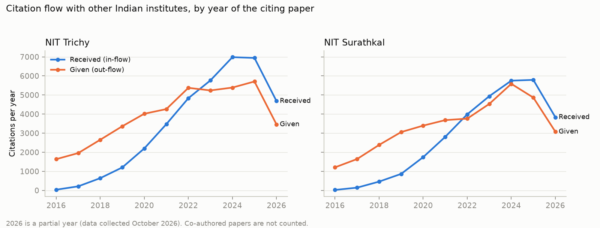
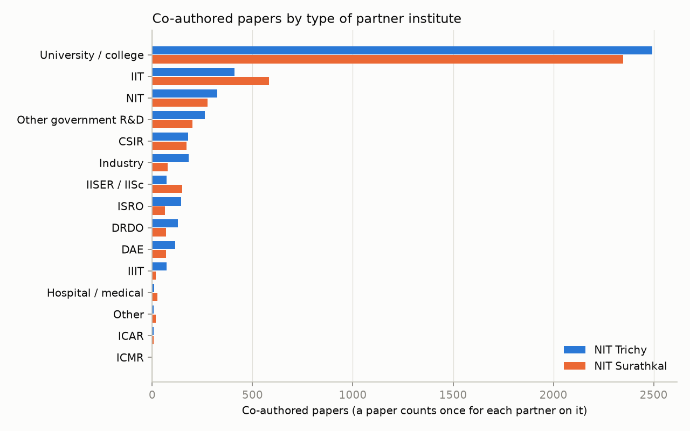

# Team 12: new analyses (faculty only, science / engineering papers)

Dataset: 18,343 papers, 21,932 (paper, faculty) rows, 663 faculty with papers. Generated by `scripts/analysis.py`.

## 1. Papers with more than 50 authors: is there a big bias?

**Before the new filters** (first version of the data, all authors and subjects) there were 3 such papers. They held 2.4% of NIT Trichy's citations, 0.1% of NIT Surathkal's citations. The largest one, *Opinion Paper: “So what if ChatGPT wrote it?” Multidisciplinary perspectives on opportunit...* (4,455 citations), was the most-cited paper of the whole dataset. It is a Social Sciences paper, so the subject filter now removes it.

**Now** (faculty only, science/engineering only) there are 0 (institution, paper) rows with more than 50 authors:

none

Institute totals with each cut-off:

| max_authors | institution | papers_removed | papers | citations | cites_per_paper | median_cites | mean_fwci |
|---|---|---|---|---|---|---|---|
| none | NIT Trichy | 0 | 9184 | 140035 | 15.25 | 6.00 | 1.31 |
| none | NIT Surathkal | 0 | 9206 | 125280 | 13.61 | 5.00 | 1.39 |
| 20 | NIT Trichy | 0 | 9184 | 140035 | 15.25 | 6.00 | 1.31 |
| 20 | NIT Surathkal | 1 | 9205 | 125280 | 13.61 | 5.00 | 1.39 |
| 30 | NIT Trichy | 0 | 9184 | 140035 | 15.25 | 6.00 | 1.31 |
| 30 | NIT Surathkal | 0 | 9206 | 125280 | 13.61 | 5.00 | 1.39 |
| 50 | NIT Trichy | 0 | 9184 | 140035 | 15.25 | 6.00 | 1.31 |
| 50 | NIT Surathkal | 0 | 9206 | 125280 | 13.61 | 5.00 | 1.39 |
| 100 | NIT Trichy | 0 | 9184 | 140035 | 15.25 | 6.00 | 1.31 |
| 100 | NIT Surathkal | 0 | 9206 | 125280 | 13.61 | 5.00 | 1.39 |

Faculty rankings compared with keeping every paper (Spearman correlation; 1 = identical order):

| max_authors | measure | spearman_vs_all_papers | faculty_whose_value_changes |
|---|---|---|---|
| 20 | papers | 1.0000 | 1 |
| 20 | citations | 1.0000 | 0 |
| 20 | h_index | 1.0000 | 0 |
| 30 | papers | 1.0000 | 0 |
| 30 | citations | 1.0000 | 0 |
| 30 | h_index | 1.0000 | 0 |
| 50 | papers | 1.0000 | 0 |
| 50 | citations | 1.0000 | 0 |
| 50 | h_index | 1.0000 | 0 |
| 100 | papers | 1.0000 | 0 |
| 100 | citations | 1.0000 | 0 |
| 100 | h_index | 1.0000 | 0 |
| fractional | papers | 0.9779 | 663 |

Faculty co-authorship network with each cut-off:

| max_authors | papers_skipped | pair_rows | faculty_nodes | faculty_edges | communities | modularity | largest_component | spearman_degree | spearman_betweenness | top20_betweenness_overlap |
|---|---|---|---|---|---|---|---|---|---|---|
| none | 0 | 25691 | 663 | 967 | 162 | 0.8437 | 496 | 1.0000 | 1.0000 | 20 |
| 20 | 1 | 25670 | 663 | 967 | 162 | 0.8437 | 496 | 1.0000 | 1.0000 | 20 |
| 30 | 0 | 25691 | 663 | 967 | 162 | 0.8437 | 496 | 1.0000 | 1.0000 | 20 |
| 50 | 0 | 25691 | 663 | 967 | 162 | 0.8437 | 496 | 1.0000 | 1.0000 | 20 |
| 100 | 0 | 25691 | 663 | 967 | 162 | 0.8437 | 496 | 1.0000 | 1.0000 | 20 |

**Verdict:** with the 50-author cut-off the faculty rankings keep a rank correlation of at least 1.000 with the full data, and institute totals change by 0.0% of NIT Trichy's citations, 0.0% of NIT Surathkal's citations. After the faculty and subject filters, large papers no longer bias the results much; the 50-author rule is kept for the authorship network as standard practice.

## 2. Which institute performs better?

Counted per institute: a paper written by faculty of both NITs counts for each. `cites_per_paper_ci` is a 95% bootstrap interval. FWCI = OpenAlex field-weighted citation impact (1.0 = world average for that field and year).

| measure | NIT Trichy | NIT Surathkal |
|---|---|---|
| papers | 9184 | 9206 |
| citations | 140035 | 125280 |
| cites_per_paper | 15.25 | 13.61 |
| cites_per_paper_ci | 14.66-15.84 | 13.08-14.16 |
| median_cites | 6.00 | 5.00 |
| mean_fwci | 1.31 | 1.39 |
| top10pct_share | 0.14 | 0.14 |
| q1_share_of_ranked_journals | 0.35 | 0.38 |
| conference_share | 0.20 | 0.32 |
| indian_collab_share | 0.35 | 0.31 |
| foreign_collab_share | 0.17 | 0.14 |
| faculty | 357 | 306 |
| papers_per_faculty | 25.73 | 30.08 |
| faculty_in_roster | 431 | 380 |
| current_faculty | 344 | 269 |
| median_h_index_2016_2026 | 7.00 | 8.00 |
| median_h_index_openalex | 11 | 13 |

Per-faculty comparison (Mann-Whitney U test, faculty with at least one paper):

| per_faculty_measure | median_NIT Trichy | median_NIT Surathkal | mann_whitney_p | difference_is_significant_5pct |
|---|---|---|---|---|
| papers | 19 | 31 | 0.002 | True |
| citations_in_period | 192 | 260 | 0.015 | True |
| h_index_2016_2026 | 7.000 | 8.000 | 0.024 | True |
| mean_fwci | 1.016 | 1.074 | 0.155 | False |

Papers per year:

| year | NIT Surathkal | NIT Trichy |
|---|---|---|
| 2016 | 527 | 550 |
| 2017 | 631 | 568 |
| 2018 | 878 | 774 |
| 2019 | 844 | 895 |
| 2020 | 967 | 990 |
| 2021 | 850 | 883 |
| 2022 | 852 | 967 |
| 2023 | 1011 | 1031 |
| 2024 | 1117 | 939 |
| 2025 | 939 | 989 |
| 2026 | 590 | 598 |

## 2b. Measures asked for in class

**IF** here is OpenAlex's *2-year mean citedness* of the journal: citations in a year to the journal's papers of the two previous years, divided by the number of those papers. That is the impact-factor formula on OpenAlex data, because Clarivate's JCR impact factor is not open. Conference papers have no IF.

| institution | publications | journal_papers | Q1 | IF>5 | IF>10 | share_IF>5 | share_IF>10 |
|---|---|---|---|---|---|---|---|
| NIT Surathkal | 9,206 | 6,284 | 2,222 | 2,124 | 280 | 0.338 | 0.045 |
| NIT Trichy | 9,184 | 7,322 | 2,391 | 2,413 | 352 | 0.330 | 0.048 |

By branch:

| institution | department | publications | journal_papers | Q1 | IF>5 | IF>10 | share_IF>5 | share_IF>10 |
|---|---|---|---|---|---|---|---|---|
| NIT Surathkal | CSE | 960 | 361 | 149 | 130 | 8.000 | 0.360 | 0.022 |
| NIT Surathkal | Chemical | 393 | 384 | 164 | 185 | 24 | 0.482 | 0.062 |
| NIT Surathkal | Chemistry | 773 | 747 | 323 | 360 | 40 | 0.482 | 0.054 |
| NIT Surathkal | Civil | 1,008 | 606 | 235 | 199 | 66 | 0.328 | 0.109 |
| NIT Surathkal | ECE | 816 | 471 | 146 | 139 | 5.000 | 0.295 | 0.011 |
| NIT Surathkal | EEE | 824 | 393 | 210 | 131 | 18 | 0.333 | 0.046 |
| NIT Surathkal | Information Technology | 659 | 214 | 97 | 91 | 9.000 | 0.425 | 0.042 |
| NIT Surathkal | MME | 560 | 509 | 137 | 160 | 19 | 0.314 | 0.037 |
| NIT Surathkal | Mathematics | 525 | 432 | 55 | 27 | 0.000 | 0.062 | 0.000 |
| NIT Surathkal | Mechanical | 1,770 | 1,424 | 477 | 513 | 77 | 0.360 | 0.054 |
| NIT Surathkal | Mining | 203 | 155 | 21 | 24 | 1.000 | 0.155 | 0.006 |
| NIT Surathkal | Physics | 437 | 402 | 193 | 179 | 18 | 0.445 | 0.045 |
| NIT Surathkal | Water Resources & Ocean | 590 | 416 | 114 | 89 | 9.000 | 0.214 | 0.022 |
| NIT Trichy | Architecture | 94 | 63 | 19 | 18 | 0.000 | 0.286 | 0.000 |
| NIT Trichy | CSE | 704 | 393 | 113 | 134 | 7.000 | 0.341 | 0.018 |
| NIT Trichy | Chemical | 654 | 636 | 297 | 317 | 93 | 0.498 | 0.146 |
| NIT Trichy | Chemistry | 761 | 758 | 288 | 318 | 57 | 0.420 | 0.075 |
| NIT Trichy | Civil | 779 | 623 | 255 | 189 | 40 | 0.303 | 0.064 |
| NIT Trichy | Computer Applications | 612 | 408 | 113 | 126 | 5.000 | 0.309 | 0.012 |
| NIT Trichy | ECE | 1,131 | 693 | 151 | 108 | 5.000 | 0.156 | 0.007 |
| NIT Trichy | EEE | 858 | 490 | 212 | 128 | 31 | 0.261 | 0.063 |
| NIT Trichy | Energy & Environment | 115 | 96 | 55 | 56 | 19 | 0.583 | 0.198 |
| NIT Trichy | ICE | 440 | 291 | 91 | 71 | 4.000 | 0.244 | 0.014 |
| NIT Trichy | MME | 554 | 528 | 153 | 216 | 12 | 0.409 | 0.023 |
| NIT Trichy | Mathematics | 300 | 284 | 77 | 29 | 0.000 | 0.102 | 0.000 |
| NIT Trichy | Mechanical | 766 | 716 | 247 | 285 | 63 | 0.398 | 0.088 |
| NIT Trichy | Physics | 817 | 734 | 241 | 266 | 20 | 0.362 | 0.027 |
| NIT Trichy | Production | 873 | 841 | 164 | 251 | 18 | 0.298 | 0.021 |

**Impact ratio** = citations received / citations made (references), for papers published 2016-2026. The Indian version counts only citations from / to other Indian institutes, with the co-authorship rule (in_indian / out_indian edges, by the citing paper's year).

| institution | received | made | indian_received | indian_made | impact_ratio | indian_impact_ratio |
|---|---|---|---|---|---|---|
| NIT Surathkal | 125280 | 312861 | 30,349 | 37,191 | 0.400 | 0.816 |
| NIT Trichy | 140035 | 317797 | 36,970 | 43,057 | 0.441 | 0.859 |

By year:

| institution | year | received | made | indian_received | indian_made | impact_ratio | indian_impact_ratio |
|---|---|---|---|---|---|---|---|
| NIT Surathkal | 2016 | 12118 | 13591 | 26 | 1,209 | 0.892 | 0.022 |
| NIT Surathkal | 2017 | 14585 | 17588 | 144 | 1,644 | 0.829 | 0.088 |
| NIT Surathkal | 2018 | 18294 | 23906 | 461 | 2,384 | 0.765 | 0.193 |
| NIT Surathkal | 2019 | 17768 | 27405 | 866 | 3,057 | 0.648 | 0.283 |
| NIT Surathkal | 2020 | 16777 | 31077 | 1,743 | 3,395 | 0.540 | 0.513 |
| NIT Surathkal | 2021 | 14646 | 31867 | 2,806 | 3,683 | 0.460 | 0.762 |
| NIT Surathkal | 2022 | 10920 | 31409 | 3,987 | 3,761 | 0.348 | 1.060 |
| NIT Surathkal | 2023 | 9765 | 35986 | 4,937 | 4,532 | 0.271 | 1.089 |
| NIT Surathkal | 2024 | 7511 | 41453 | 5,751 | 5,585 | 0.181 | 1.030 |
| NIT Surathkal | 2025 | 2681 | 37770 | 5,792 | 4,865 | 0.071 | 1.191 |
| NIT Surathkal | 2026 | 215 | 20809 | 3,836 | 3,076 | 0.010 | 1.247 |
| NIT Trichy | 2016 | 13922 | 14762 | 37 | 1,637 | 0.943 | 0.023 |
| NIT Trichy | 2017 | 12678 | 15276 | 213 | 1,956 | 0.830 | 0.109 |
| NIT Trichy | 2018 | 19764 | 23219 | 642 | 2,654 | 0.851 | 0.242 |
| NIT Trichy | 2019 | 19381 | 27171 | 1,204 | 3,362 | 0.713 | 0.358 |
| NIT Trichy | 2020 | 23714 | 33036 | 2,200 | 4,017 | 0.718 | 0.548 |
| NIT Trichy | 2021 | 17174 | 34865 | 3,471 | 4,261 | 0.493 | 0.815 |
| NIT Trichy | 2022 | 13376 | 36779 | 4,832 | 5,375 | 0.364 | 0.899 |
| NIT Trichy | 2023 | 11031 | 38080 | 5,764 | 5,239 | 0.290 | 1.100 |
| NIT Trichy | 2024 | 6144 | 35488 | 6,982 | 5,389 | 0.173 | 1.296 |
| NIT Trichy | 2025 | 2664 | 36939 | 6,942 | 5,707 | 0.072 | 1.216 |
| NIT Trichy | 2026 | 187 | 22182 | 4,683 | 3,460 | 0.008 | 1.353 |

## 3. Which branch performs better?

Branches ranked by mean_fwci (branches with fewer than 8 publishing faculty left out):

| institution | branch | faculty | papers | papers_per_faculty | cites_per_paper | mean_fwci | top10pct_share | q1_share_of_ranked_journals |
|---|---|---|---|---|---|---|---|---|
| NIT Surathkal | Civil | 38 | 1008 | 26.53 | 12.43 | 1.92 | 0.19 | 0.43 |
| NIT Surathkal | Mechanical | 52 | 1770 | 34.04 | 17.16 | 1.67 | 0.18 | 0.38 |
| NIT Trichy | Computer Applications | 24 | 612 | 25.50 | 13.71 | 1.66 | 0.19 | 0.30 |
| NIT Trichy | Civil | 37 | 779 | 21.05 | 14.47 | 1.66 | 0.17 | 0.44 |
| NIT Surathkal | Water Resources & Ocean | 21 | 590 | 28.10 | 12.02 | 1.64 | 0.17 | 0.30 |
| NIT Trichy | Chemical | 22 | 654 | 29.73 | 26.30 | 1.59 | 0.16 | 0.49 |
| NIT Trichy | Production | 36 | 873 | 24.25 | 20.86 | 1.58 | 0.18 | 0.23 |
| NIT Surathkal | CSE | 17 | 960 | 56.47 | 10.54 | 1.54 | 0.17 | 0.43 |
| NIT Surathkal | Chemistry | 14 | 773 | 55.21 | 23.57 | 1.53 | 0.17 | 0.45 |
| NIT Trichy | Mathematics | 21 | 300 | 14.29 | 9.52 | 1.47 | 0.15 | 0.28 |
| NIT Surathkal | Information Technology | 16 | 659 | 41.19 | 9.83 | 1.46 | 0.16 | 0.46 |
| NIT Trichy | Mechanical | 29 | 766 | 26.41 | 18.83 | 1.42 | 0.16 | 0.39 |
| NIT Trichy | Chemistry | 16 | 761 | 47.56 | 24.22 | 1.34 | 0.16 | 0.39 |
| NIT Surathkal | Mining | 14 | 203 | 14.50 | 9.60 | 1.28 | 0.10 | 0.15 |
| NIT Surathkal | Chemical | 20 | 393 | 19.65 | 22.32 | 1.26 | 0.12 | 0.45 |
| NIT Surathkal | EEE | 31 | 824 | 26.58 | 11.36 | 1.22 | 0.12 | 0.55 |
| NIT Trichy | ECE | 34 | 1131 | 33.26 | 10.08 | 1.18 | 0.13 | 0.23 |
| NIT Trichy | MME | 21 | 554 | 26.38 | 13.47 | 1.13 | 0.11 | 0.35 |
| NIT Trichy | ICE | 16 | 440 | 27.50 | 8.67 | 1.08 | 0.11 | 0.34 |
| NIT Surathkal | Physics | 12 | 437 | 36.42 | 18.06 | 1.05 | 0.09 | 0.51 |
| NIT Trichy | Physics | 17 | 817 | 48.06 | 18.03 | 1.04 | 0.08 | 0.34 |
| NIT Surathkal | MME | 17 | 560 | 32.94 | 13.51 | 1.01 | 0.10 | 0.30 |
| NIT Surathkal | ECE | 30 | 816 | 27.20 | 9.45 | 1.00 | 0.09 | 0.32 |
| NIT Trichy | CSE | 29 | 704 | 24.28 | 7.37 | 1.00 | 0.11 | 0.31 |
| NIT Trichy | Architecture | 14 | 94 | 6.71 | 5.16 | 0.99 | 0.11 | 0.34 |
| NIT Trichy | EEE | 35 | 858 | 24.51 | 10.26 | 0.97 | 0.10 | 0.45 |
| NIT Surathkal | Mathematics | 23 | 525 | 22.83 | 3.65 | 0.60 | 0.05 | 0.15 |

Head-to-head for branches both NITs have (T = NIT Trichy, S = NIT Surathkal):

| branch | papers_per_faculty T | papers_per_faculty S | cites_per_paper T | cites_per_paper S | mean_fwci T | mean_fwci S | stronger_on_fwci |
|---|---|---|---|---|---|---|---|
| CSE | 24.28 | 56.47 | 7.37 | 10.54 | 1.00 | 1.54 | NIT Surathkal |
| Chemical | 29.73 | 19.65 | 26.30 | 22.32 | 1.59 | 1.26 | NIT Trichy |
| Chemistry | 47.56 | 55.21 | 24.22 | 23.57 | 1.34 | 1.53 | NIT Surathkal |
| Civil | 21.05 | 26.53 | 14.47 | 12.43 | 1.66 | 1.92 | NIT Surathkal |
| ECE | 33.26 | 27.20 | 10.08 | 9.45 | 1.18 | 1.00 | NIT Trichy |
| EEE | 24.51 | 26.58 | 10.26 | 11.36 | 0.97 | 1.22 | NIT Surathkal |
| MME | 26.38 | 32.94 | 13.47 | 13.51 | 1.13 | 1.01 | NIT Trichy |
| Mathematics | 14.29 | 22.83 | 9.52 | 3.65 | 1.47 | 0.60 | NIT Trichy |
| Mechanical | 26.41 | 34.04 | 18.83 | 17.16 | 1.42 | 1.67 | NIT Surathkal |
| Physics | 48.06 | 36.42 | 18.03 | 18.06 | 1.04 | 1.05 | NIT Surathkal |

## 4. Collaborate with whom, and what to improve

### NIT Trichy

Strongest current partners (all of NIT Trichy's papers: 15.2 citations per paper, mean FWCI 1.31):

| partner | shared_papers | joint_cites_per_paper | joint_mean_fwci | exchange | topic_weighted_jaccard |
|---|---|---|---|---|---|
| Vellore Institute of Technology University | 216 | 16.76 | 1.40 | 3314 | 0.56 |
| SRM Institute of Science and Technology | 155 | 11.08 | 1.01 | 2305 | 0.50 |
| Indian Institute of Technology Madras | 119 | 11.68 | 0.99 | 2352 | 0.50 |
| Bharathidasan University | 109 | 16.75 | 1.18 | 659 | 0.28 |
| Anna University, Chennai | 108 | 32.10 | 2.07 | 2378 | 0.62 |
| Bharat Heavy Electricals (India) | 94 | 13.66 | 0.91 | 56 | 0.43 |
| Amrita Vishwa Vidyapeetham | 90 | 5.92 | 1.35 | 894 | 0.42 |
| SASTRA University | 88 | 9.02 | 0.95 | 585 | 0.52 |
| National Institute of Technology Calicut | 57 | 16.95 | 1.47 | 615 | 0.63 |
| Indian Space Research Organisation | 56 | 22.21 | 1.51 | 255 | 0.26 |

**Partners worth approaching**: strong citation exchange and similar research topics, but at most 5 joint papers so far (score = topic similarity x log(citation exchange) / log(joint papers + 2)):

| partner | shared_papers | cites_from_partner | cites_to_partner | topic_weighted_jaccard | topic_jaccard_top40 | opportunity_score |
|---|---|---|---|---|---|---|
| Netaji Subhas University of Technology | 0 | 163 | 103 | 0.549 | 0.538 | 4.422 |
| GLA University | 0 | 287 | 138 | 0.471 | 0.481 | 4.117 |
| New Horizon College of Engineering | 0 | 143 | 25 | 0.532 | 0.600 | 3.936 |
| Savitribai Phule Pune University | 0 | 254 | 312 | 0.413 | 0.509 | 3.781 |
| Sant Longowal Institute of Engineering and Technology | 0 | 102 | 86 | 0.479 | 0.481 | 3.624 |
| Shivaji University | 0 | 106 | 238 | 0.389 | 0.404 | 3.276 |
| Indian Institute of Information Technology Design and Manufacturing Jabalpur | 1 | 136 | 120 | 0.536 | 0.538 | 2.708 |
| Graphic Era University | 1 | 397 | 120 | 0.454 | 0.600 | 2.584 |
| Aligarh Muslim University | 0 | 289 | 338 | 0.273 | 0.404 | 2.539 |
| Sri Sairam Engineering College | 1 | 138 | 104 | 0.496 | 0.569 | 2.480 |

### NIT Surathkal

Strongest current partners (all of NIT Surathkal's papers: 13.6 citations per paper, mean FWCI 1.39):

| partner | shared_papers | joint_cites_per_paper | joint_mean_fwci | exchange | topic_weighted_jaccard |
|---|---|---|---|---|---|
| Manipal Academy of Higher Education | 461 | 15.80 | 1.46 | 1156 | 0.27 |
| Vellore Institute of Technology University | 158 | 15.99 | 1.23 | 2439 | 0.54 |
| Indian Institute of Science Bangalore | 126 | 12.84 | 0.99 | 2172 | 0.45 |
| Nitte University | 114 | 6.61 | 1.73 | 273 | 0.26 |
| Siddaganga Institute of Technology | 100 | 11.39 | 1.56 | 569 | 0.57 |
| Indian Institute of Technology Madras | 79 | 17.30 | 1.41 | 2413 | 0.54 |
| Indian Institute of Technology Kharagpur | 72 | 13.35 | 1.37 | 2198 | 0.54 |
| Visvesvaraya Technological University | 70 | 20 | 1.63 | 1027 | 0.54 |
| Indian Institute of Technology Bombay | 64 | 13.12 | 1.19 | 1688 | 0.52 |
| Kasturba Medical College, Manipal | 64 | 17.86 | 1.44 | 67 | 0.04 |

**Partners worth approaching**: strong citation exchange and similar research topics, but at most 5 joint papers so far (score = topic similarity x log(citation exchange) / log(joint papers + 2)):

| partner | shared_papers | cites_from_partner | cites_to_partner | topic_weighted_jaccard | topic_jaccard_top40 | opportunity_score |
|---|---|---|---|---|---|---|
| Sant Longowal Institute of Engineering and Technology | 0 | 58 | 191 | 0.470 | 0.481 | 3.748 |
| Chitkara University | 0 | 378 | 73 | 0.401 | 0.481 | 3.539 |
| Sri Sairam Engineering College | 0 | 57 | 71 | 0.490 | 0.509 | 3.436 |
| Indian Institute of Information Technology Design and Manufacturing Jabalpur | 0 | 65 | 79 | 0.456 | 0.429 | 3.273 |
| National Institute of Technology Kurukshetra | 1 | 156 | 258 | 0.560 | 0.569 | 3.075 |
| Shivaji University | 0 | 104 | 204 | 0.354 | 0.404 | 2.929 |
| Karunya University | 1 | 162 | 147 | 0.516 | 0.633 | 2.695 |
| Chandigarh University | 1 | 529 | 137 | 0.453 | 0.509 | 2.684 |
| Vel Tech Rangarajan Dr. Sagunthala R&D Institute of Science and Technology | 1 | 263 | 116 | 0.491 | 0.538 | 2.654 |
| Thapar Institute of Engineering & Technology | 2 | 242 | 418 | 0.561 | 0.633 | 2.627 |

### NIT Trichy and NIT Surathkal together

Only 47 papers have faculty authors from both NITs. Branches where one NIT is clearly stronger are natural places to start joint work:

| branch | NIT Surathkal | NIT Trichy | gap | learn_from |
|---|---|---|---|---|
| Mathematics | 0.60 | 1.47 | 0.87 | NIT Trichy |
| CSE | 1.54 | 1.00 | -0.54 | NIT Surathkal |
| Chemical | 1.26 | 1.59 | 0.33 | NIT Trichy |
| Civil | 1.92 | 1.66 | -0.26 | NIT Surathkal |
| EEE | 1.22 | 0.97 | -0.26 | NIT Surathkal |
| Mechanical | 1.67 | 1.42 | -0.25 | NIT Surathkal |
| Chemistry | 1.53 | 1.34 | -0.18 | NIT Surathkal |
| ECE | 1.00 | 1.18 | 0.18 | NIT Trichy |
| MME | 1.01 | 1.13 | 0.11 | NIT Trichy |
| Physics | 1.05 | 1.04 | -0.01 | NIT Surathkal |

**Areas to improve** (the two weakest regular-size branches on each measure):

| institution | measure | branch | value | institute_value |
|---|---|---|---|---|
| NIT Trichy | mean_fwci | EEE | 0.968 | 1.306 |
| NIT Trichy | mean_fwci | Architecture | 0.985 | 1.306 |
| NIT Trichy | q1_share_of_ranked_journals | ECE | 0.225 | 0.352 |
| NIT Trichy | q1_share_of_ranked_journals | Production | 0.225 | 0.352 |
| NIT Trichy | foreign_collab_share | CSE | 0.023 | 0.171 |
| NIT Trichy | foreign_collab_share | Architecture | 0.043 | 0.171 |
| NIT Surathkal | mean_fwci | Mathematics | 0.599 | 1.388 |
| NIT Surathkal | mean_fwci | ECE | 1.005 | 1.388 |
| NIT Surathkal | q1_share_of_ranked_journals | Mining | 0.147 | 0.383 |
| NIT Surathkal | q1_share_of_ranked_journals | Mathematics | 0.149 | 0.383 |
| NIT Surathkal | foreign_collab_share | CSE | 0.062 | 0.144 |
| NIT Surathkal | foreign_collab_share | Information Technology | 0.065 | 0.144 |

## 5. Task 3: Indian connectivity

All counts follow the co-authorship rule (`scripts/flow.py`): a citation between papers that share an institute through co-authorship is not counted as flow between institutes.

### Citation flow

Citations **received from** and **given to** other Indian institutes (2016–2026, by year of the citing paper), and the citation impact ratio (received / given):

| institution | received | given | ratio_received_to_given |
|---|---|---|---|
| NIT Surathkal | 30349 | 37191 | 0.816 |
| NIT Trichy | 36970 | 43057 | 0.859 |

The yearly ratio rises from about 0.02 in 2016 to above 1 from 2023. Part of this is timing: our papers are from 2016 onwards, so in the early years they had little time to be cited, while they cite older work at once. The ratio above 1 in recent years means both NITs now receive more citations from other Indian institutes than they give.

By year (`task3_flow_by_year.csv`):

| institution | year | given | received | ratio_received_to_given |
|---|---|---|---|---|
| NIT Surathkal | 2016 | 1209 | 26 | 0.02 |
| NIT Surathkal | 2017 | 1644 | 144 | 0.09 |
| NIT Surathkal | 2018 | 2384 | 461 | 0.19 |
| NIT Surathkal | 2019 | 3057 | 866 | 0.28 |
| NIT Surathkal | 2020 | 3395 | 1743 | 0.51 |
| NIT Surathkal | 2021 | 3683 | 2806 | 0.76 |
| NIT Surathkal | 2022 | 3761 | 3987 | 1.06 |
| NIT Surathkal | 2023 | 4532 | 4937 | 1.09 |
| NIT Surathkal | 2024 | 5585 | 5751 | 1.03 |
| NIT Surathkal | 2025 | 4865 | 5792 | 1.19 |
| NIT Surathkal | 2026 | 3076 | 3836 | 1.25 |
| NIT Trichy | 2016 | 1637 | 37 | 0.02 |
| NIT Trichy | 2017 | 1956 | 213 | 0.11 |
| NIT Trichy | 2018 | 2654 | 642 | 0.24 |
| NIT Trichy | 2019 | 3362 | 1204 | 0.36 |
| NIT Trichy | 2020 | 4017 | 2200 | 0.55 |
| NIT Trichy | 2021 | 4261 | 3471 | 0.81 |
| NIT Trichy | 2022 | 5375 | 4832 | 0.90 |
| NIT Trichy | 2023 | 5239 | 5764 | 1.10 |
| NIT Trichy | 2024 | 5389 | 6982 | 1.30 |
| NIT Trichy | 2025 | 5707 | 6942 | 1.22 |
| NIT Trichy | 2026 | 3460 | 4683 | 1.35 |

### Top 10 Indian institutes citing each NIT

The other NIT is left out of this list.

| your_inst | partner_inst | partner_cluster | cites_from_partner | cites_to_partner | shared_papers |
|---|---|---|---|---|---|
| NIT Trichy | Vellore Institute of Technology University | University / college | 1953 | 1361 | 216 |
| NIT Trichy | Saveetha University | University / college | 1745 | 343 | 42 |
| NIT Trichy | SRM Institute of Science and Technology | University / college | 1648 | 657 | 155 |
| NIT Trichy | Anna University, Chennai | University / college | 841 | 1537 | 108 |
| NIT Trichy | Chandigarh University | University / college | 629 | 168 | 8 |
| NIT Trichy | Vel Tech Rangarajan Dr. Sagunthala R&D Institute of Science and Technology | University / college | 610 | 181 | 47 |
| NIT Trichy | Manipal Academy of Higher Education | University / college | 607 | 253 | 46 |
| NIT Trichy | Indian Institute of Technology Roorkee | IIT | 604 | 1456 | 46 |
| NIT Trichy | Indian Institute of Technology Delhi | IIT | 589 | 1668 | 38 |
| NIT Trichy | Amrita Vishwa Vidyapeetham | University / college | 564 | 330 | 90 |
| NIT Surathkal | Vellore Institute of Technology University | University / college | 1388 | 1051 | 158 |
| NIT Surathkal | SRM Institute of Science and Technology | University / college | 925 | 494 | 38 |
| NIT Surathkal | Manipal Academy of Higher Education | University / college | 898 | 258 | 461 |
| NIT Surathkal | Saveetha University | University / college | 879 | 231 | 19 |
| NIT Surathkal | Visvesvaraya Technological University | University / college | 854 | 173 | 70 |
| NIT Surathkal | Lovely Professional University | University / college | 583 | 165 | 4 |
| NIT Surathkal | Indian Institute of Science Bangalore | IISER / IISc | 569 | 1603 | 126 |
| NIT Surathkal | Chandigarh University | University / college | 529 | 137 | 1 |
| NIT Surathkal | Jain University | University / college | 512 | 122 | 18 |
| NIT Surathkal | Indian Institute of Technology Roorkee | IIT | 505 | 1698 | 17 |

### Top 10 most-cited papers that cite each NIT

Papers by other Indian institutes that cite our work, ranked by their own citation count (retracted papers left out):

| institution | citing_paper | year | venue | its_citations | citing_institutes | our_papers_it_cites |
|---|---|---|---|---|---|---|
| NIT Trichy | Microneedles: A smart approach and increasing potential for transdermal drug delivery syst | 2018 | Biomedicine & Pharmacotherapy | 1264 | Birla Institute of Technology and Science, Pilani;Jaipur Nat | 2 |
| NIT Trichy | An overview on the removal of synthetic dyes from water by electrochemical advanced oxidat | 2018 | Chemosphere | 1140 | National Environmental Engineering Research Institute | 1 |
| NIT Trichy | Fueling the future: A comprehensive review of hydrogen energy systems and their challenges | 2023 | International Journal of Hydrogen Energy | 789 | Rajiv Gandhi Institute of Petroleum Technology | 1 |
| NIT Trichy | Climate change and COP26: Are digital technologies and information management part of the  | 2021 | International Journal of Information Management | 756 | IBM (India);Indian Institute of Management Bangalore;Indian  | 1 |
| NIT Trichy | A critical review on the fused deposition modeling of thermoplastic polymer composites | 2020 | Composites Part B Engineering | 707 | Birla Institute of Technology and Science - Hyderabad Campus | 1 |
| NIT Trichy | AI for next generation computing: Emerging trends and future directions | 2022 | Internet of Things | 686 | Indian Institute of Technology Kharagpur;Indian Institute of | 1 |
| NIT Trichy | Recent progress in aluminum metal matrix composites: A review on processing, mechanical an | 2020 | Journal of Manufacturing Processes | 647 | Indian Institute of Technology Bhubaneswar | 1 |
| NIT Trichy | Environment friendly, renewable and sustainable poly lactic acid (PLA) based natural fiber | 2021 | Journal of Cleaner Production | 642 | Harcourt Butler Technical University;PSG INSTITUTE OF TECHNO | 1 |
| NIT Trichy | Perovskite Oxide Based Materials for Energy and Environment-Oriented Photocatalysis | 2020 | ACS Catalysis | 637 | Indian Institute of Technology Mandi | 2 |
| NIT Trichy | Techno-economic assessment of various hydrogen production methods – A review | 2020 | Bioresource Technology | 620 | Anna University, Chennai;Central University of Tamil Nadu | 2 |
| NIT Surathkal | A review on heavy metal pollution, toxicity and remedial measures: Current trends and futu | 2019 | Journal of Molecular Liquids | 1611 | Central Leather Research Institute;Council of Scientific and | 1 |
| NIT Surathkal | A survey on sentiment analysis methods, applications, and challenges | 2022 | Artificial Intelligence Review | 1535 | Dayananda Sagar College of Engineering;Indian Institute of T | 1 |
| NIT Surathkal | Using Machine Learning to Identify Diseases and Perform Sorting in Apple Fruit | 2024 | International Journal of Innovative Science and Research Technology (IJISRT) | 963 | Indian Institute of Technology Kharagpur | 1 |
| NIT Surathkal | Green Synthesis of Metallic Nanoparticles: Applications and Limitations | 2021 | Catalysts | 886 | Sharda University | 1 |
| NIT Surathkal | Structure, Properties and Applications of Two‐Dimensional Hexagonal Boron Nitride | 2021 | Advanced Materials | 872 | Vikramajit Singh Sanatan Dharma College | 1 |
| NIT Surathkal | Geopolymers as an alternative to Portland cement: An overview | 2019 | Construction and Building Materials | 821 | Sharda University | 1 |
| NIT Surathkal | Polymeric composite materials for radiation shielding: a review | 2021 | Environmental Chemistry Letters | 715 | Dr. Babasaheb Ambedkar Marathwada University | 1 |
| NIT Surathkal | Biological approaches to tackle heavy metal pollution: A survey of literature | 2018 | Journal of Environmental Management | 691 | APJ Abdul Kalam Technological University;Anna University, Ch | 1 |
| NIT Surathkal | A comprehensive review on green synthesis of nature-inspired metal nanoparticles: Mechanis | 2020 | Journal of Cleaner Production | 677 | Indian Institute of Technology Dhanbad | 1 |
| NIT Surathkal | Green synthesis of TiO2 nanoparticles using leaf extract of Jatropha curcas L. for photoca | 2017 | Chemical Engineering Journal | 658 | Babasaheb Bhimrao Ambedkar University | 1 |

### Connectivity map

NIT Trichy's faculty co-authored with **464 Indian institutes**. NIT Surathkal's faculty co-authored with **471 Indian institutes**. Every partner has a cluster (from its name, its OpenAlex type and its parent organisation); a link is **cross-cluster** when the partner is not an NIT.

| your_inst | partner_cluster | partners | co_author_partners | shared_papers | cites_from_partner | cites_to_partner | cross_cluster |
|---|---|---|---|---|---|---|---|
| NIT Surathkal | CSIR | 41 | 24 | 172 | 1033 | 3800 | True |
| NIT Surathkal | DAE | 21 | 14 | 69 | 408 | 1092 | True |
| NIT Surathkal | DRDO | 41 | 11 | 69 | 165 | 540 | True |
| NIT Surathkal | Hospital / medical | 108 | 14 | 27 | 172 | 134 | True |
| NIT Surathkal | ICAR | 68 | 3 | 8 | 288 | 478 | True |
| NIT Surathkal | ICMR | 15 | 0 | 0 | 24 | 38 | True |
| NIT Surathkal | IIIT | 20 | 7 | 17 | 364 | 437 | True |
| NIT Surathkal | IISER / IISc | 8 | 6 | 149 | 732 | 1887 | True |
| NIT Surathkal | IIT | 23 | 23 | 583 | 4490 | 12034 | True |
| NIT Surathkal | ISRO | 10 | 8 | 63 | 244 | 592 | True |
| NIT Surathkal | Industry | 107 | 22 | 77 | 229 | 478 | True |
| NIT Surathkal | NIT | 24 | 22 | 277 | 4159 | 3906 | False |
| NIT Surathkal | Other | 56 | 5 | 19 | 122 | 211 | True |
| NIT Surathkal | Other government R&D | 240 | 51 | 200 | 1467 | 2646 | True |
| NIT Surathkal | University / college | 1229 | 261 | 2347 | 36502 | 26254 | True |
| NIT Trichy | CSIR | 41 | 17 | 180 | 1471 | 3887 | True |
| NIT Trichy | DAE | 20 | 9 | 114 | 468 | 1595 | True |
| NIT Trichy | DRDO | 45 | 15 | 128 | 265 | 738 | True |
| NIT Trichy | Hospital / medical | 97 | 8 | 9 | 123 | 148 | True |
| NIT Trichy | ICAR | 68 | 3 | 8 | 344 | 394 | True |
| NIT Trichy | ICMR | 14 | 0 | 0 | 11 | 36 | True |
| NIT Trichy | IIIT | 21 | 9 | 72 | 429 | 539 | True |
| NIT Trichy | IISER / IISc | 8 | 6 | 71 | 425 | 1418 | True |
| NIT Trichy | IIT | 23 | 19 | 411 | 5194 | 12073 | True |
| NIT Trichy | ISRO | 10 | 8 | 145 | 216 | 418 | True |
| NIT Trichy | Industry | 106 | 30 | 181 | 210 | 505 | True |
| NIT Trichy | NIT | 24 | 22 | 323 | 4460 | 4620 | False |
| NIT Trichy | Other | 73 | 4 | 7 | 130 | 256 | True |
| NIT Trichy | Other government R&D | 225 | 40 | 262 | 1474 | 2349 | True |
| NIT Trichy | University / college | 1265 | 274 | 2492 | 44826 | 34516 | True |

Strongest co-authorship partners (top 15 per NIT):

| your_inst | partner_inst | partner_cluster | cross_cluster | shared_papers | total_citations |
|---|---|---|---|---|---|
| NIT Trichy | Vellore Institute of Technology University | University / college | True | 216 | 3620 |
| NIT Trichy | SRM Institute of Science and Technology | University / college | True | 155 | 1718 |
| NIT Trichy | Indian Institute of Technology Madras | IIT | True | 119 | 1390 |
| NIT Trichy | Bharathidasan University | University / college | True | 109 | 1826 |
| NIT Trichy | Anna University, Chennai | University / college | True | 108 | 3467 |
| NIT Trichy | Bharat Heavy Electricals (India) | Industry | True | 94 | 1284 |
| NIT Trichy | Amrita Vishwa Vidyapeetham | University / college | True | 90 | 533 |
| NIT Trichy | SASTRA University | University / college | True | 88 | 794 |
| NIT Trichy | National Institute of Technology Calicut | NIT | False | 57 | 966 |
| NIT Trichy | Indian Space Research Organisation | ISRO | True | 56 | 1244 |
| NIT Trichy | Indira Gandhi Centre for Atomic Research | DAE | True | 55 | 566 |
| NIT Trichy | National Institute of Technology Warangal | NIT | False | 54 | 1291 |
| NIT Trichy | Indian Institute of Science Bangalore | IISER / IISc | True | 54 | 1464 |
| NIT Trichy | Thiagarajar College of Engineering | University / college | True | 54 | 539 |
| NIT Trichy | Vikram Sarabhai Space Centre | ISRO | True | 49 | 479 |
| NIT Surathkal | Manipal Academy of Higher Education | University / college | True | 461 | 7283 |
| NIT Surathkal | Vellore Institute of Technology University | University / college | True | 158 | 2527 |
| NIT Surathkal | Indian Institute of Science Bangalore | IISER / IISc | True | 126 | 1618 |
| NIT Surathkal | Nitte University | University / college | True | 114 | 753 |
| NIT Surathkal | Siddaganga Institute of Technology | University / college | True | 100 | 1139 |
| NIT Surathkal | Indian Institute of Technology Madras | IIT | True | 79 | 1367 |
| NIT Surathkal | Indian Institute of Technology Kharagpur | IIT | True | 72 | 961 |
| NIT Surathkal | Visvesvaraya Technological University | University / college | True | 70 | 1400 |
| NIT Surathkal | Indian Institute of Technology Bombay | IIT | True | 64 | 840 |
| NIT Surathkal | Kasturba Medical College, Manipal | University / college | True | 64 | 1143 |
| NIT Surathkal | National Institute of Technology Calicut | NIT | False | 58 | 617 |
| NIT Surathkal | Amrita Vishwa Vidyapeetham | University / college | True | 57 | 626 |
| NIT Surathkal | Kasturba Medical College, Mangalore | University / college | True | 57 | 1184 |
| NIT Surathkal | Indian Institute of Technology Delhi | IIT | True | 52 | 824 |
| NIT Surathkal | Nitte Meenakshi Institute of Technology | University / college | True | 49 | 838 |

### Research-topic similarity (Jaccard)

Jaccard similarity of research subfields between each NIT and its main partners: `topic_jaccard_top40` compares the 40 largest subfields of each side; `topic_weighted_jaccard` compares their full subfield shares (1 = identical mix).

| institution | partner | partner_cluster | topic_jaccard_top40 | topic_weighted_jaccard | shared_papers |
|---|---|---|---|---|---|
| NIT Trichy | Maulana Azad National Institute of Technology | NIT | 0.600 | 0.642 | 22 |
| NIT Trichy | National Institute of Technology Warangal | NIT | 0.667 | 0.640 | 54 |
| NIT Trichy | National Institute of Technology Jamshedpur | NIT | 0.538 | 0.638 | 4 |
| NIT Trichy | Sri Sivasubramaniya Nadar College of Engineering | University / college | 0.600 | 0.635 | 42 |
| NIT Trichy | National Institute of Technology Calicut | NIT | 0.702 | 0.628 | 57 |
| NIT Trichy | Anna University, Chennai | University / college | 0.600 | 0.620 | 108 |
| NIT Trichy | National Institute of Technology Agartala | NIT | 0.569 | 0.609 | 5 |
| NIT Trichy | National Institute of Technology Durgapur | NIT | 0.633 | 0.605 | 3 |
| NIT Trichy | Aditya University | University / college | 0.600 | 0.604 | 3 |
| NIT Trichy | Pandit Deendayal Energy University | University / college | 0.569 | 0.601 | 24 |
| NIT Surathkal | National Institute of Technology Calicut | NIT | 0.667 | 0.652 | 58 |
| NIT Surathkal | National Institute of Technology Warangal | NIT | 0.702 | 0.645 | 26 |
| NIT Surathkal | Maulana Azad National Institute of Technology | NIT | 0.667 | 0.613 | 4 |
| NIT Surathkal | National Institute of Technology Agartala | NIT | 0.633 | 0.612 | 5 |
| NIT Surathkal | National Institute of Technology Jamshedpur | NIT | 0.569 | 0.604 | 2 |
| NIT Surathkal | Anna University, Chennai | University / college | 0.702 | 0.602 | 16 |
| NIT Surathkal | Aditya University | University / college | 0.600 | 0.598 | 29 |
| NIT Surathkal | Indian Institute of Technology Dhanbad | IIT | 0.569 | 0.597 | 34 |
| NIT Surathkal | National Institute of Technology Rourkela | NIT | 0.569 | 0.597 | 45 |
| NIT Surathkal | Indian Institute of Engineering Science and Technology, Shibpur | University / college | 0.569 | 0.590 | 3 |

### Hub authors

Faculty who link their NIT with the most other Indian institutes (`indian_partner_institutes`), with their betweenness in the faculty co-authorship network:

| institution | author | branch | indian_partner_institutes | degree | betweenness_centrality | papers |
|---|---|---|---|---|---|---|
| NIT Trichy | S Anandan | Chemistry | 42 | 5 | 0.0157 | 267 |
| NIT Trichy | R Karvembu | Chemistry | 41 | 6 | 0.0091 | 145 |
| NIT Trichy | S Suresh | Mechanical | 37 | 14 | 0.0215 | 156 |
| NIT Trichy | N V Giridharan | Physics | 35 | 5 | 0.0138 | 75 |
| NIT Trichy | G Arthanareeswaran | Chemical | 29 | 9 | 0.0131 | 171 |
| NIT Trichy | P Sivashanmugam | Chemical | 29 | 4 | 0.0014 | 77 |
| NIT Trichy | N Siva Shanmugam | Mechanical | 27 | 9 | 0.0571 | 153 |
| NIT Trichy | S Saravanan | Civil | 27 | 6 | 0.0276 | 94 |
| NIT Trichy | Siva Prasad Katakam | MME | 27 | 10 | 0.0096 | 76 |
| NIT Trichy | M Ashok | Physics | 26 | 7 | 0.0123 | 72 |
| NIT Surathkal | Ramesh M R | Mechanical | 53 | 22 | 0.0987 | 179 |
| NIT Surathkal | Shashi Bhushan Arya | MME | 37 | 13 | 0.0254 | 61 |
| NIT Surathkal | Mohammad Rizwanur Rahman | MME | 36 | 12 | 0.0365 | 54 |
| NIT Surathkal | Kartick Tarafder | Physics | 35 | 11 | 0.0102 | 69 |
| NIT Surathkal | Udaya Kumar Dalimba | Chemistry | 33 | 4 | 0.0025 | 63 |
| NIT Surathkal | Srikanth Bontha | Mechanical | 24 | 12 | 0.0083 | 68 |
| NIT Surathkal | Sib Sankar Mal | Chemistry | 24 | 7 | 0.0032 | 87 |
| NIT Surathkal | Udaya Bhat K | MME | 23 | 15 | 0.0380 | 125 |
| NIT Surathkal | Bibhuti Bhusan Das | Civil | 23 | 7 | 0.0167 | 123 |
| NIT Surathkal | Sushil Kumar Pandey | ECE | 23 | 4 | 0.0006 | 49 |

