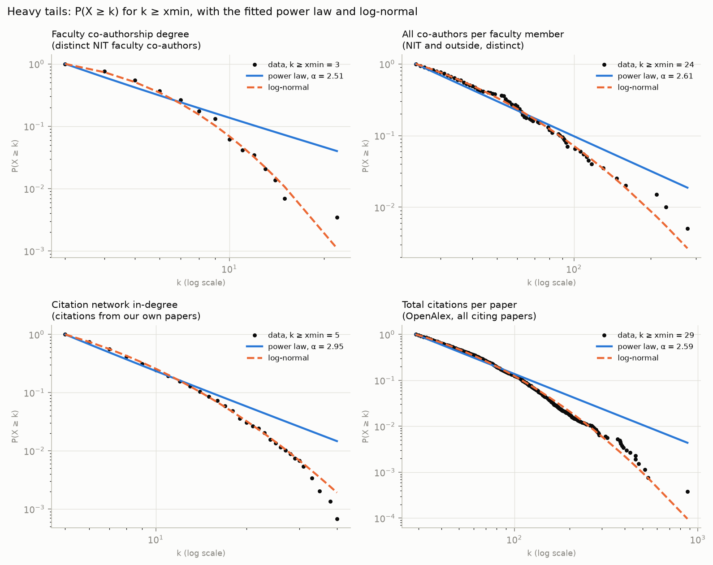
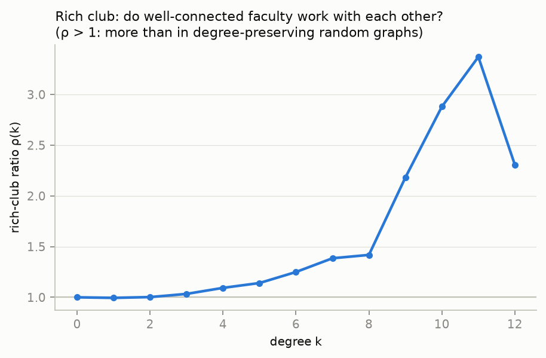
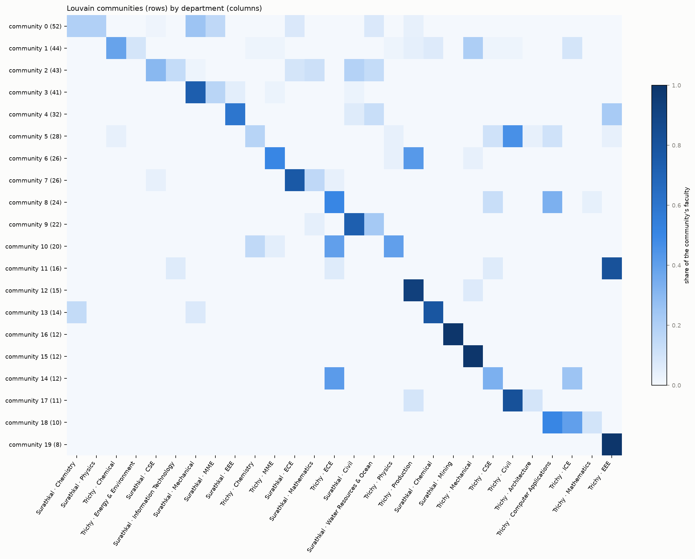
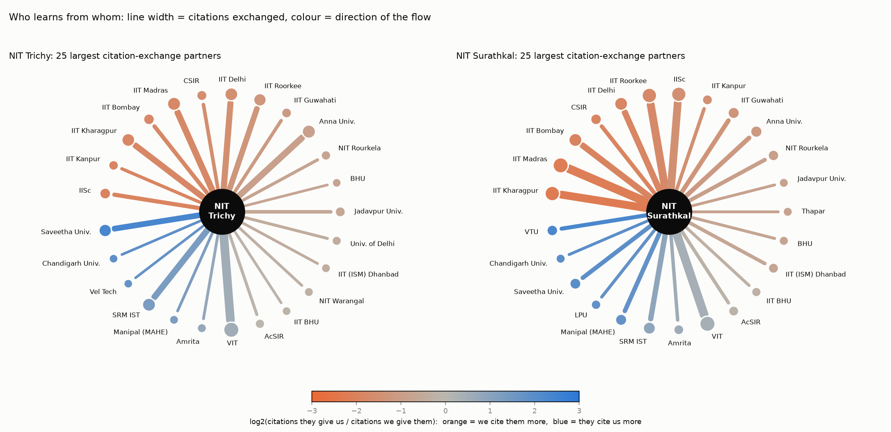
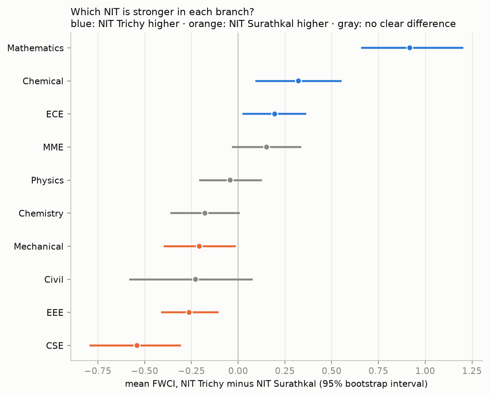

# Team 12: network-science analyses

Faculty co-authorship network: 656 faculty, 961 links. Generated by `scripts/network_science.py`.

## 1. Degree distributions: power law or log-normal?

Fitted with the `powerlaw` package (Clauset-Shalizi-Newman method: maximum likelihood, xmin chosen by the Kolmogorov-Smirnov distance). `R` > 0 favours the power law and `R` < 0 the other distribution; `p` < 0.1 means the difference is significant.

| distribution | n | mean | max | xmin | alpha | alpha_se | tail_size | R_vs_lognormal | p_vs_lognormal | R_vs_exponential | p_vs_exponential | verdict |
|---|---|---|---|---|---|---|---|---|---|---|---|---|
| Faculty co-authorship degree | 539 | 3.566 | 22 | 3.000 | 2.507 | 0.088 | 290 | -5.496 | 0.000 | -7.375 | 0.000 | log-normal fits better than a power law |
| All co-authors per faculty member | 637 | 22.140 | 278 | 24 | 2.611 | 0.114 | 199 | -2.153 | 0.031 | -0.295 | 0.768 | log-normal fits better than a power law |
| Citation network in-degree | 7656 | 3.112 | 40 | 5.000 | 2.949 | 0.051 | 1474 | -5.887 | 0.000 | -2.233 | 0.026 | log-normal fits better than a power law |
| Total citations per paper | 14871 | 17.781 | 877 | 29 | 2.585 | 0.031 | 2639 | -6.915 | 0.000 | 0.953 | 0.341 | log-normal fits better than a power law |

## 2. Is the faculty network a small world, and who works with whom?

Null models: 20 degree-preserving rewirings (double-edge swaps) and 20 Erdos-Renyi graphs of the same size. Small-world index σ = (C / C_rand) / (L / L_rand) with the rewired graphs = **16.1** (σ > 1 means small world): clustering is 21.9× the rewired value while paths are only 1.35× as long.

| graph | nodes | edges | avg_clustering | transitivity | avg_path_length |
|---|---|---|---|---|---|
| Faculty network (largest component) | 492 | 930 | 0.212 | 0.205 | 6.100 |
| Same degrees, rewired (mean of 20) | 492 | 930 | 0.010 | 0.012 | 4.504 |
| Random (Erdos-Renyi, mean of 20) | 492 | 930 | 0.006 | 0.007 | 4.741 |

**Rich club:** the normalised coefficient peaks at ρ = 3.37 for k > 11 (10 faculty). Values above 1 mean the best-connected faculty co-author with each other more than chance predicts.

**Assortativity:** 69% of faculty-faculty links join two people of the same branch. The z-score compares each value with 200 random relabellings.

| attribute | assortativity | null_mean | z_score |
|---|---|---|---|
| degree | 0.202 |  |  |
| branch | 0.663 | -0.003 | 72.995 |
| institution | 0.941 | -0.005 | 31.635 |
| designation | 0.073 | -0.006 | 4.060 |

**k-cores:** the innermost core is the 4-core, with 36 faculty:

| faculty | institution | branch | degree |
|---|---|---|---|
| Badekai Ramachandra Bhat | NIT Surathkal | Chemistry | 8 |
| B Rajasekaran | NIT Surathkal | MME | 5 |
| Mohammad Rizwanur Rahman | NIT Surathkal | MME | 12 |
| Preetham Kumar G V | NIT Surathkal | MME | 6 |
| Shashi Bhushan Arya | NIT Surathkal | MME | 13 |
| Udaya Bhat K | NIT Surathkal | MME | 15 |
| A S S Balan | NIT Surathkal | Mechanical | 9 |
| Ajay Kumar Yadav | NIT Surathkal | Mechanical | 9 |
| Arumuga Perumal D | NIT Surathkal | Mechanical | 7 |
| G C Mohan Kumar | NIT Surathkal | Mechanical | 7 |
| Gangadharan K V | NIT Surathkal | Mechanical | 14 |
| H Suresh Hebbar | NIT Surathkal | Mechanical | 4 |
| Hemantha Kumar | NIT Surathkal | Mechanical | 12 |
| Jeyaraj P | NIT Surathkal | Mechanical | 9 |
| Kumar G N | NIT Surathkal | Mechanical | 8 |
| Mervin Arunaraj Herbert | NIT Surathkal | Mechanical | 7 |
| Mrityunjay R Doddamani | NIT Surathkal | Mechanical | 5 |
| N Gnanasekaran | NIT Surathkal | Mechanical | 9 |
| Narendranath S | NIT Surathkal | Mechanical | 9 |
| Prasad Krishna | NIT Surathkal | Mechanical | 8 |
| Ramesh M R | NIT Surathkal | Mechanical | 22 |
| Ravikiran Kadoli | NIT Surathkal | Mechanical | 5 |
| S M Murigendrappa | NIT Surathkal | Mechanical | 4 |
| Satyabodh M Kulkarni | NIT Surathkal | Mechanical | 6 |
| Sharnappa Joladarashi | NIT Surathkal | Mechanical | 12 |
| Shivananda Nayaka H | NIT Surathkal | Mechanical | 5 |
| Srikanth Bontha | NIT Surathkal | Mechanical | 12 |
| Subhaschandra Kattimani | NIT Surathkal | Mechanical | 9 |
| Vijay Desai | NIT Surathkal | Mechanical | 7 |
| Akhil Avchar | NIT Surathkal | Mining | 6 |
| Amrites Senapati | NIT Surathkal | Mining | 5 |
| Bijay Mihir Kunar | NIT Surathkal | Mining | 6 |
| Chivukula Suryanarayana Murthy | NIT Surathkal | Mining | 8 |
| Harsha Vardhan | NIT Surathkal | Mining | 10 |
| Mangalpady Aruna | NIT Surathkal | Mining | 11 |
| Nagaraja H S | NIT Surathkal | Physics | 10 |

Faculty per core number: k=1: 185, k=2: 145, k=3: 173, k=4: 36

## 3. Do the collaboration communities follow the departments?

NMI = 1 would mean every Louvain community is exactly one department; 0 means no relation. Here **NMI = 0.68** (a random assignment would give 0.24) and ARI = 0.34: communities are strongly shaped by department, but not identical to them.

| comparison | NMI | ARI | NMI_if_random |
|---|---|---|---|
| Louvain communities vs department (institute + branch) | 0.678 | 0.344 | 0.240 |
| Louvain communities vs institute | 0.302 | 0.083 |  |

Communities with 8+ faculty (20); **10** of them draw less than 60% of their members from one department. These are the cross-department groups:

| community | faculty | main_department | share_of_main_department | departments | mix |
|---|---|---|---|---|---|
| 0 | 52 | NIT Surathkal · Mechanical | 0.25 | 8 | NIT Surathkal · Mechanical (13); NIT Surathkal · Physics (10); NIT Surathkal · Chemistry (10); NIT Surathkal · MME (8) |
| 1 | 44 | NIT Trichy · Chemical | 0.39 | 11 | NIT Trichy · Chemical (17); NIT Trichy · Mechanical (9); NIT Trichy · ICE (4); NIT Trichy · Energy & Environment (4) |
| 2 | 43 | NIT Surathkal · CSE | 0.30 | 7 | NIT Surathkal · CSE (13); NIT Surathkal · Civil (8); NIT Surathkal · Water Resources & Ocean (6); NIT Surathkal · Information Technology (6) |
| 3 | 41 | NIT Surathkal · Mechanical | 0.73 | 5 | NIT Surathkal · Mechanical (30); NIT Surathkal · MME (7); NIT Surathkal · EEE (2); NIT Trichy · MME (1) |
| 4 | 32 | NIT Surathkal · EEE | 0.59 | 4 | NIT Surathkal · EEE (19); NIT Trichy · EEE (7); NIT Surathkal · Water Resources & Ocean (4); NIT Surathkal · Civil (2) |
| 5 | 28 | NIT Trichy · Civil | 0.46 | 8 | NIT Trichy · Civil (13); NIT Trichy · Chemistry (5); NIT Trichy · CSE (3); NIT Trichy · Computer Applications (3) |
| 6 | 26 | NIT Trichy · MME | 0.50 | 4 | NIT Trichy · MME (13); NIT Trichy · Production (11); NIT Trichy · Physics (1); NIT Trichy · Mechanical (1) |
| 7 | 26 | NIT Surathkal · ECE | 0.77 | 4 | NIT Surathkal · ECE (20); NIT Surathkal · Mathematics (4); NIT Surathkal · CSE (1); NIT Trichy · ECE (1) |
| 8 | 24 | NIT Trichy · ECE | 0.50 | 4 | NIT Trichy · ECE (12); NIT Trichy · Computer Applications (8); NIT Trichy · CSE (3); NIT Trichy · Mathematics (1) |
| 9 | 22 | NIT Surathkal · Civil | 0.73 | 3 | NIT Surathkal · Civil (16); NIT Surathkal · Water Resources & Ocean (5); NIT Surathkal · Mathematics (1) |
| 10 | 20 | NIT Trichy · Physics | 0.40 | 4 | NIT Trichy · Physics (8); NIT Trichy · ECE (8); NIT Trichy · Chemistry (3); NIT Trichy · MME (1) |
| 11 | 16 | NIT Trichy · EEE | 0.81 | 4 | NIT Trichy · EEE (13); NIT Surathkal · Information Technology (1); NIT Trichy · CSE (1); NIT Trichy · ECE (1) |
| 12 | 15 | NIT Trichy · Production | 0.93 | 2 | NIT Trichy · Production (14); NIT Trichy · Mechanical (1) |
| 13 | 14 | NIT Surathkal · Chemical | 0.79 | 3 | NIT Surathkal · Chemical (11); NIT Surathkal · Chemistry (2); NIT Surathkal · Mechanical (1) |
| 16 | 12 | NIT Surathkal · Mining | 1.00 | 1 | NIT Surathkal · Mining (12) |
| 15 | 12 | NIT Trichy · Mechanical | 1.00 | 1 | NIT Trichy · Mechanical (12) |
| 14 | 12 | NIT Trichy · ECE | 0.42 | 3 | NIT Trichy · ECE (5); NIT Trichy · CSE (4); NIT Trichy · ICE (3) |
| 17 | 11 | NIT Trichy · Civil | 0.82 | 3 | NIT Trichy · Civil (9); NIT Trichy · Architecture (1); NIT Trichy · Production (1) |
| 18 | 10 | NIT Trichy · Computer Applications | 0.50 | 3 | NIT Trichy · Computer Applications (5); NIT Trichy · ICE (4); NIT Trichy · Mathematics (1) |
| 19 | 8 | NIT Trichy · EEE | 1.00 | 1 | NIT Trichy · EEE (8) |

## 4. The institute-level citation-flow network

Nodes are institutes. An arrow A → B weighted w means A's papers cite B's papers w times (with the co-authorship rule). This is the part of the Indian citation network that touches our two NITs, so the two NITs are the hubs by design; the interesting part is the direction and balance of each partner's exchange. Weighted reciprocity of the whole network = **0.64** (1 = every citation is returned in equal measure).

Partners with 50+ citations exchanged, by direction of the flow ('they mostly cite us' = more than twice as many citations from them as to them):

| institution | balanced | they mostly cite us | we mostly cite them |
|---|---|---|---|
| NIT Surathkal | 196 | 95 | 84 |
| NIT Trichy | 233 | 97 | 79 |

By cluster (`received_per_given` > 1: that cluster draws on our work more than we draw on theirs):

| institution | cluster | partners | they_cite_us | we_cite_them | received_per_given |
|---|---|---|---|---|---|
| NIT Surathkal | CSIR | 25 | 981 | 3574 | 0.27 |
| NIT Surathkal | DAE | 7 | 372 | 997 | 0.37 |
| NIT Surathkal | DRDO | 2 | 72 | 262 | 0.27 |
| NIT Surathkal | ICAR | 3 | 125 | 171 | 0.73 |
| NIT Surathkal | IIIT | 5 | 254 | 338 | 0.75 |
| NIT Surathkal | IISER / IISc | 7 | 721 | 1879 | 0.38 |
| NIT Surathkal | IIT | 22 | 4478 | 12027 | 0.37 |
| NIT Surathkal | ISRO | 5 | 216 | 554 | 0.39 |
| NIT Surathkal | Industry | 2 | 46 | 99 | 0.46 |
| NIT Surathkal | NIT | 23 | 4129 | 3896 | 1.06 |
| NIT Surathkal | Other | 1 | 16 | 65 | 0.25 |
| NIT Surathkal | Other government R&D | 16 | 723 | 1365 | 0.53 |
| NIT Surathkal | University / college | 257 | 30764 | 22373 | 1.38 |
| NIT Trichy | CSIR | 25 | 1383 | 3666 | 0.38 |
| NIT Trichy | DAE | 8 | 434 | 1505 | 0.29 |
| NIT Trichy | DRDO | 5 | 149 | 544 | 0.27 |
| NIT Trichy | ICAR | 2 | 124 | 138 | 0.90 |
| NIT Trichy | IIIT | 6 | 322 | 437 | 0.74 |
| NIT Trichy | IISER / IISc | 5 | 398 | 1379 | 0.29 |
| NIT Trichy | IIT | 21 | 5159 | 12052 | 0.43 |
| NIT Trichy | ISRO | 3 | 154 | 318 | 0.48 |
| NIT Trichy | Industry | 3 | 49 | 160 | 0.31 |
| NIT Trichy | NIT | 23 | 4447 | 4611 | 0.96 |
| NIT Trichy | Other | 1 | 21 | 71 | 0.30 |
| NIT Trichy | Other government R&D | 21 | 754 | 1327 | 0.57 |
| NIT Trichy | University / college | 286 | 38877 | 30277 | 1.28 |

Weighted PageRank (top 15):

| institute | cluster | pagerank |
|---|---|---|
| NIT Trichy | NIT | 0.2445 |
| NIT Surathkal | NIT | 0.2015 |
| Indian Institute of Technology Madras | IIT | 0.0122 |
| Indian Institute of Technology Kharagpur | IIT | 0.0114 |
| Indian Institute of Technology Roorkee | IIT | 0.0101 |
| Indian Institute of Technology Delhi | IIT | 0.0096 |
| Indian Institute of Science Bangalore | IISER / IISc | 0.0089 |
| Indian Institute of Technology Bombay | IIT | 0.0079 |
| Vellore Institute of Technology University | University / college | 0.0078 |
| Anna University, Chennai | University / college | 0.0077 |
| Council of Scientific and Industrial Research | CSIR | 0.0056 |
| Indian Institute of Technology Guwahati | IIT | 0.0052 |
| Indian Institute of Technology Kanpur | IIT | 0.0048 |
| National Institute of Technology Rourkela | NIT | 0.0042 |
| SRM Institute of Science and Technology | University / college | 0.0038 |

## 5. A fair comparison of the two institutes

Raw mean FWCI: NIT Trichy 1.31, NIT Surathkal 1.39. But the two NITs publish in different branches, years and collaboration patterns, so the raw gap can mislead. We regress log(1 + FWCI) of each paper on an NIT Surathkal indicator, adding controls step by step (OLS with robust standard errors, one row per institute and paper):

| model | NIT Surathkal effect on log(1+FWCI) | 95% CI | p_value | approx_%_difference | R2 | papers |
|---|---|---|---|---|---|---|
| year only | 0.006 | -0.011 to 0.023 | 0.493 | 0.598 | 0.029 | 18342 |
| + branch | -0.006 | -0.024 to 0.013 | 0.556 | -0.559 | 0.051 | 18342 |
| + branch, collaboration, venue, team size | 0.011 | -0.007 to 0.030 | 0.225 | 1.150 | 0.078 | 18342 |

Other effects in the full model:

| variable | coefficient | p_value | approx_%_difference |
|---|---|---|---|
| foreign | 0.139 | 0.000 | 14.938 |
| indian_collab | -0.013 | 0.186 | -1.338 |
| conference | -0.153 | 0.000 | -14.175 |
| log_authors | 0.108 | 0.000 | 11.410 |

Branch by branch, with a 95% bootstrap interval for the difference in mean FWCI (2000 resamples; branches with at least 30 papers at each NIT):

| branch | papers_T | papers_S | fwci_T | fwci_S | difference_T_minus_S | ci_low | ci_high | verdict |
|---|---|---|---|---|---|---|---|---|
| CSE | 701 | 955 | 0.997 | 1.537 | -0.540 | -0.795 | -0.305 | NIT Surathkal higher |
| EEE | 851 | 816 | 0.968 | 1.229 | -0.262 | -0.411 | -0.103 | NIT Surathkal higher |
| Civil | 754 | 1005 | 1.695 | 1.922 | -0.228 | -0.582 | 0.077 | no clear difference |
| Mechanical | 731 | 1715 | 1.426 | 1.634 | -0.208 | -0.398 | -0.012 | NIT Surathkal higher |
| Chemistry | 739 | 758 | 1.332 | 1.510 | -0.177 | -0.362 | 0.009 | no clear difference |
| Physics | 771 | 374 | 1.025 | 1.068 | -0.042 | -0.209 | 0.127 | no clear difference |
| MME | 551 | 514 | 1.130 | 0.977 | 0.152 | -0.034 | 0.338 | no clear difference |
| ECE | 1114 | 797 | 1.180 | 0.985 | 0.196 | 0.022 | 0.363 | NIT Trichy higher |
| Chemical | 651 | 388 | 1.589 | 1.267 | 0.322 | 0.093 | 0.553 | NIT Trichy higher |
| Mathematics | 296 | 500 | 1.480 | 0.563 | 0.917 | 0.657 | 1.204 | NIT Trichy higher |

