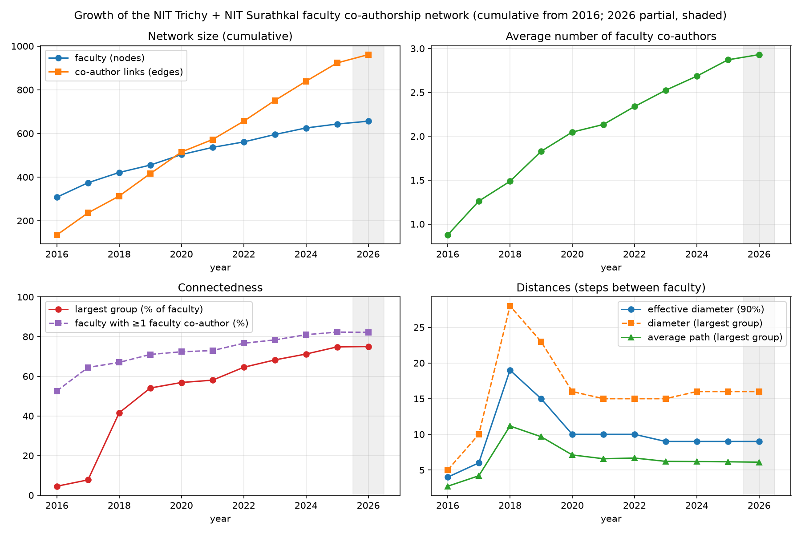
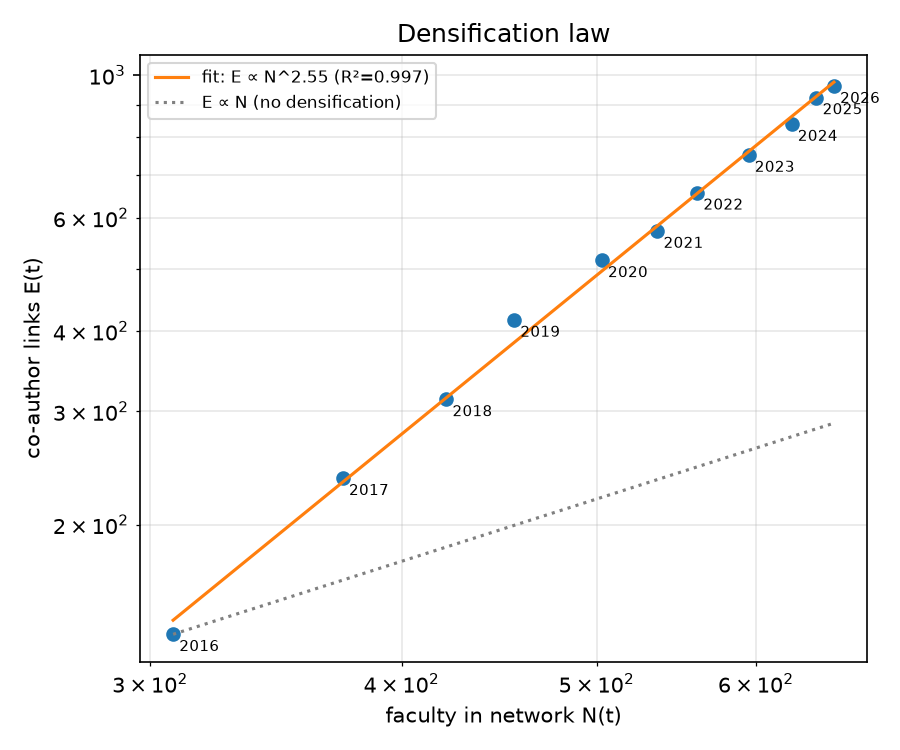
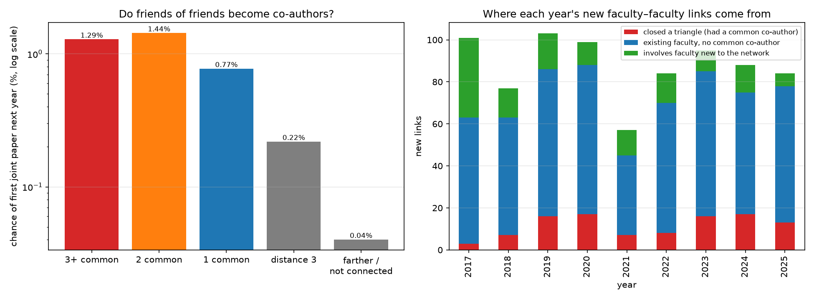
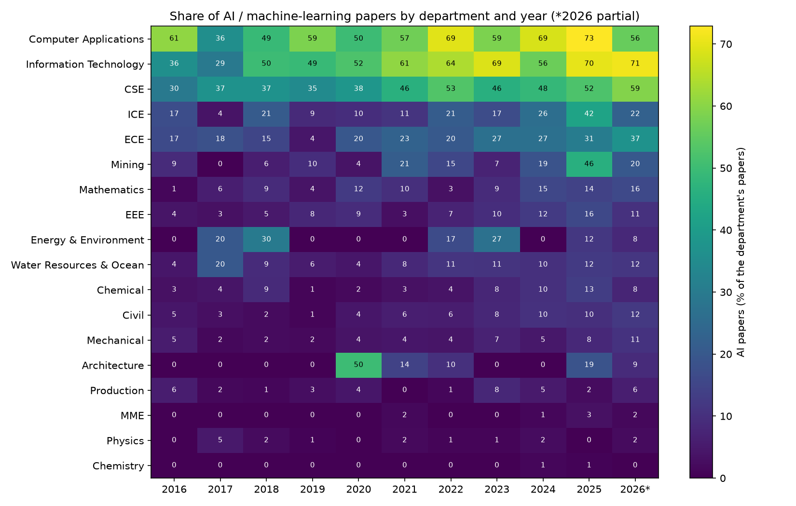
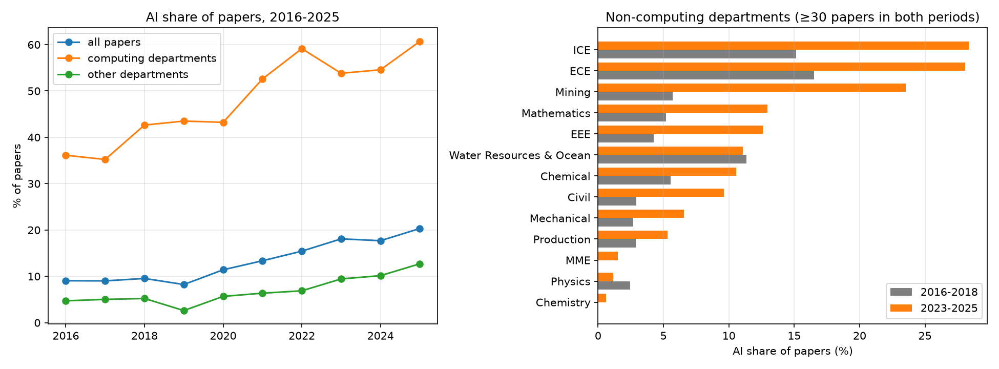
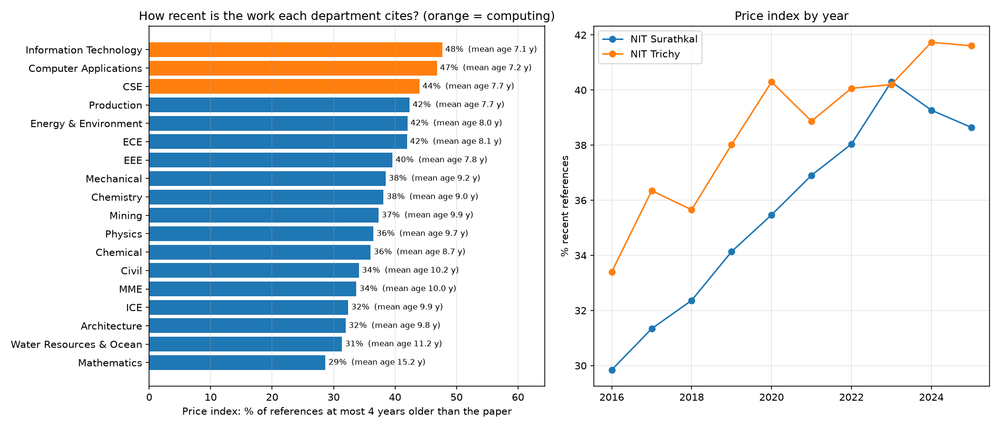
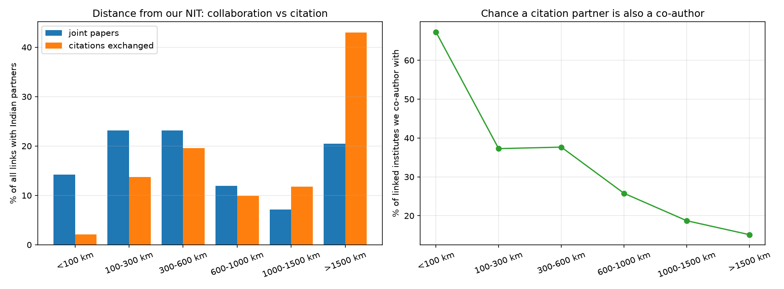
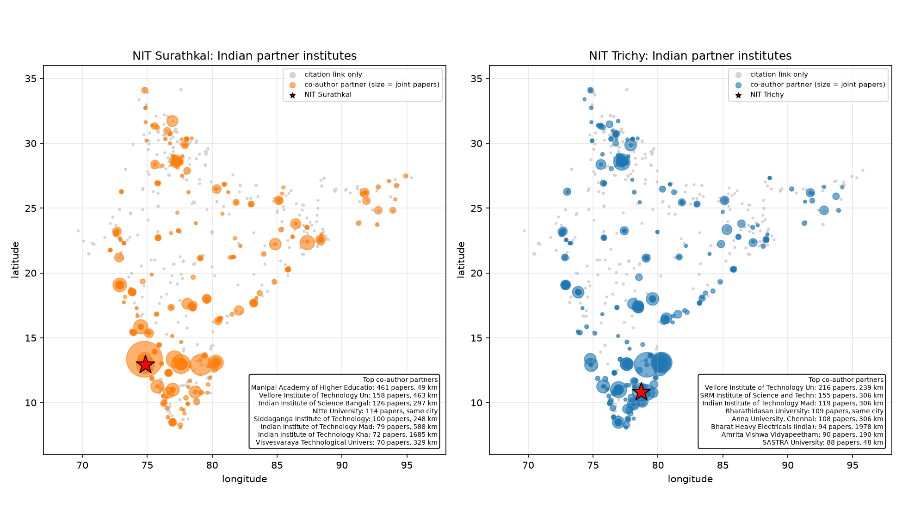
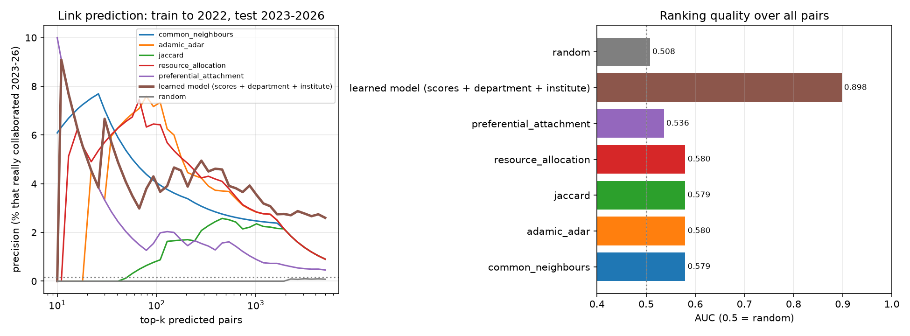
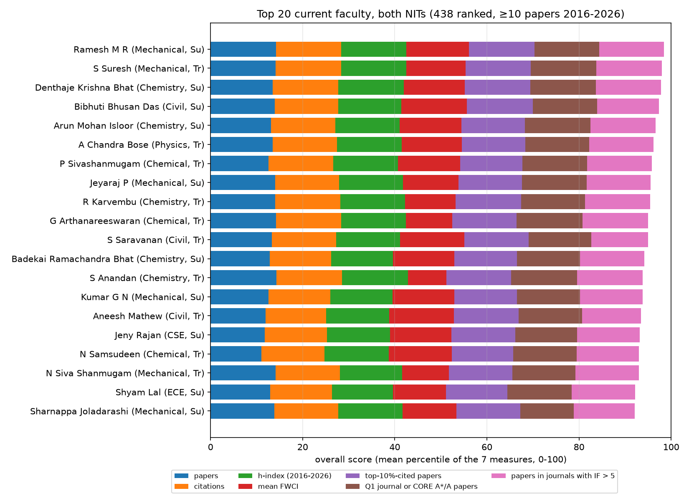

# Team 12: extra insights

**Scripts:**
- [scripts/insights.py](../../../scripts/insights.py), run as `python insights.py [network] [ai] [recency] [geo]`;
- [scripts/fetch_insights.py](../../../scripts/fetch_insights.py), which downloads the extra data.

Every number below is in the CSV/JSON files in this folder.

| Section | Question |
|---|---|
| 1 | How did the faculty network grow over time? |
| 2 | Do friends of friends become co-authors? |
| 3 | Is AI spreading into every department? |
| 4 | How recent is the work each department cites? |
| 5 | Does geography limit collaboration? |
| 6 | Can we predict future collaborations? (link prediction) |
| 7 | Which faculty are doing best? (ranking) |

---

# Sections 1–2: the faculty co-authorship network
**Network:** the **faculty-only** co-authorship network (as agreed by the team):
- 656 NIT Trichy and NIT Surathkal faculty;
- a link means the two faculty members have written at least one paper together (961 links in total).

**Years:** 2016–2026. **2026 is a partial year** (data collected in October 2026), so it's shaded in the charts and left out of year-on-year comparisons.

---

## 1. How did the network grow over time?

**Method:**
- For every year *t*, build the network of everything up to and including *t* (a cumulative network).
- A faculty member joins the network in the year of their first paper.
- A link appears in the year of the pair's first joint paper.

| | 2016 | 2018 | 2020 | 2022 | 2025 | 2026 (partial) |
|---|---|---|---|---|---|---|
| Faculty in the network | 308 | 421 | 503 | 561 | 643 | 656 |
| Co-author links | 135 | 313 | 515 | 656 | 923 | 961 |
| Average faculty co-authors per person | 0.88 | 1.49 | 2.05 | 2.34 | 2.87 | 2.93 |
| Faculty with at least one faculty co-author | 53% | 67% | 72% | 77% | 82% | 82% |
| Largest connected group (% of faculty) | 4.5% | **42%** | 57% | 65% | 75% | 75% |
| Effective diameter (90% of pairs within) | 4 | **19** | 10 | 10 | 9 | 9 |
| Modularity (Louvain) | 0.95 | 0.92 | 0.89 | 0.87 | 0.85 | 0.85 |
| Links between departments | 24% | 28% | 30% | 30% | 31% | 31% |
| Links between the two NITs | 4 | 6 | 11 | 16 | 25 | 28 |

### Findings

1. **The network densifies.** Links grow much faster than people.
   - The average number of faculty co-authors more than tripled, from 0.88 to 2.87.
   - The **densification law** (Leskovec, Kleinberg & Faloutsos 2005) holds very well. On a log–log plot, links against faculty form a straight line with slope above 1:

   | Fit | Exponent *a* in E ∝ N^a | R² |
   |---|---|---|
   | All faculty, 2016–2026 | **2.55** | 0.997 |
   | Faculty with at least one faculty co-author, 2016–2026 | **1.66** | 0.998 |
   | All faculty, 2019–2025 (start-up years dropped) | 2.29 | 0.995 |
   | Connected faculty, 2019–2025 | 1.57 | 0.998 |

   

   - *a* stays well above 1 even without the first years, so densification is real and not a start-up effect.
   - The exponent for all faculty is higher than Leskovec's networks (1.1–1.7) because our population is almost **closed**: the faculty roster is fixed, while links keep accumulating.
   - Counted over connected faculty, the exponent (about 1.6) is in the usual range.

2. **A large connected group suddenly formed in 2018.**
   - The largest group jumped from **8% to 42%** of faculty in one year.
   - This happened when the average number of co-authors passed about 1.3–1.5, the kind of sudden transition percolation theory predicts. In a random network, a giant component appears once the average degree passes 1.
   - Part of the jump is also a start-up effect: collaborations from before 2016 can't be seen, so 2016–2017 look more fragmented than they really were.

3. **The diameter shrinks.**
   - When the large group first formed in 2018, it was made of long chains: diameter 28, effective diameter 19 and average path 11.2 steps.
   - As links filled in, distances shrank: effective diameter 9 and average path 6.2 by 2025.
   - This is the **"shrinking diameter"** pattern that Leskovec et al. found in growing real-world networks.

4. **The network is slowly becoming less isolated by department, but the two NITs stay apart.**
   - Modularity fell from 0.95 to 0.85, and the share of links between departments rose from 24% to 31%.
   - Links between NIT Trichy and NIT Surathkal grew from 4 to 25, but that is still under 3% of all links.

5. **COVID dip.** 2021 had the fewest new faculty–faculty links of any full year (57, against 77–103 in other years). Joint papers also fell from 459 pair-rows in 2020 to 350 in 2021.

---

## 2. Do friends of friends become co-authors? (triadic closure)

**Method:**
- For every year *t* from 2016 to 2025, take every pair of faculty who were both already in the network and **had not yet written a paper together**. That's 1.31 million pair-years in total.
- Count how many common faculty co-authors each pair had at that point.
- Check whether the pair wrote their **first joint paper in year t+1**.
- Pool the results over all years. This is the method of Kossinets & Watts (2006) and Newman (2001).

| Pair's position in the network | Pair-years | Got a first joint paper next year | Chance next year | Chance within 3 years* | Compared with far-apart pairs |
|---|---|---|---|---|---|
| 3+ common co-authors | 233 | 3 | 1.29% | **5.5%** | 32× |
| 2 common co-authors | 1,393 | 20 | 1.44% | **4.6%** | 36× |
| 1 common co-author | 12,141 | 94 | 0.77% | **2.7%** | 19× |
| Distance 3 (friend of a friend of a friend) | 29,226 | 64 | 0.22% | 0.89% | 5.5× |
| Farther apart / not connected | 1,265,206 | 508 | 0.040% | 0.15% | 1× |

\* The 3-year column only uses years with a complete 3-year window (t ≤ 2022), because 2026 is partial.

### Findings

1. **Yes, strongly.** A faculty pair with **one common co-author is about 19 times more likely** to start collaborating the next year than a pair far apart. With two or more common co-authors it's **32–36 times** more likely.
   - The chance falls steadily with distance: 3+ common co-authors > 2 > 1 > distance 3 > farther.
   - The 3-year column shows this order most clearly. The "3+" next-year figure rests on only 3 events, so read it together with the 3-year column.

2. **It isn't just "same department".** Colleagues in the same department are naturally more likely to share co-authors, so we split the comparison:

   | | Friend of a friend | Not a friend of a friend | Ratio |
   |---|---|---|---|
   | Same department | 1.41% | 0.42% | 3.4× |
   | **Different departments** | **0.44%** | 0.017% | **26×** |

   A mutual co-author makes a **cross-department** collaboration about **26 times** more likely. That's as likely as two same-department colleagues with no mutual co-author (0.44% vs 0.42%). **Mutual co-authors are how departments get connected.**

3. **But most new links do not close a triangle.**

   | New faculty–faculty links, 2017–2025 | Links | Share |
   |---|---|---|
   | Closed a triangle (the pair already had a common faculty co-author) | 104 | 13% |
   | Existing faculty with no common faculty co-author | 549 | 70% |
   | Involve someone newly arrived in the network | 135 | 17% |

   Triadic closure is a strong pull for each individual pair, but there are very few such pairs: about 14,000 friend-of-friend pair-years against 1.3 million others. So only about 1 in 8 new links comes this way. Most new collaborations start between colleagues with no shared **faculty** co-author. The real connection is often a **PhD student or an outside co-author**, who are not nodes in this faculty-only network. The closure we measure is therefore a **lower bound**.

4. **Between the two NITs there's too little data to say.** Only 21 Trichy–Surathkal first links formed among about 656,000 cross-NIT pair-years, and only one of them was a friend-of-friend pair (`triadic_closure_by_institute.csv`).

---

## Caveats for sections 1–2 (mention them in the report)
- **Start-up effect.** Collaborations before 2016 can't be seen, so the early years look sparser than reality. That's why the densification fit was repeated on 2019–2025.
- **Joining year.** A person's first paper in 2016–2026 is used as the year they join, which approximates when they joined or became active.
- **Faculty-only.** Students and outside co-authors are not nodes, so common contacts through them are invisible (see Finding 3 of section 2).
- **2026 is partial** (until October 2026).
- **The faculty roster is fixed**, so the network can't grow beyond 656 people. This inflates the densification exponent counted over all faculty.

## Files for sections 1–2

| File | Contents |
|---|---|
| `growth_by_year.csv` | One row per year: nodes, links, new links, average degree, density, components, largest group, diameter, average path, effective diameter, clustering, transitivity, modularity, cross-NIT links and the share of cross-department links |
| `insights_summary.json` | Densification fits (all windows), headline numbers and the closure table |
| `growth_over_time.png`, `densification_loglog.png` | Growth charts |
| `triadic_closure_by_common_coauthors.csv` | The main closure table above |
| `triadic_closure_by_department.csv`, `triadic_closure_by_institute.csv` | Closure split by same or different department and institute |
| `triadic_closure_by_year.csv` | Closure probabilities for each year |
| `new_link_sources_by_year.csv` | Where each year's new links come from |
| `triadic_closure_raw_counts.csv` | Raw counts (year × group × same department × same institute) behind every table |
| `triadic_closure.png` | Closure chart and new-link sources |

**Re-run:** `python insights.py network` from `scripts/` takes about a minute. The script checks itself as it runs:
- the final network equals the 967 faculty links;
- every new link is counted exactly once;
- no link starts before both people's first paper.

---

# Section 3: Is AI spreading into every department?

**Which papers count as AI** (team decision). A paper is an AI paper if **either**:
- its OpenAlex research subfield is *Artificial Intelligence* or *Computer Vision and Pattern Recognition*, **or**
- its **title names an AI or machine-learning method**: machine learning, deep learning, neural network, CNN, LSTM, random forest, SVM, XGBoost, transformer models, LLMs and so on. The full list is `AI_PHRASES` / `AI_ACRONYMS` in `insights.py`.

**Why the title test is needed.** OpenAlex gives each paper only one main topic. A Civil paper that predicts concrete strength with a neural network is labelled *Civil Engineering*, not AI.

**Keyword list checked by hand.** Words that would give false matches are excluded:
- "transformer" on its own (power transformers in EEE);
- "GAN" (GaN = gallium nitride in ECE);
- "AI" in lower case (Al = aluminium);
- "bert" inside "Hilbert".

**Counting.** A paper counts once for each department with a faculty author on it.

**Result:** **2,614 AI papers** out of 18,343 (14%):
- 1,026 found by topic only;
- 1,140 found by title only;
- 448 found by both.

### Findings

1. **AI more than doubled overall.** The AI share of all papers went from **9.1% in 2016 to 20.3% in 2025**:

   | | 2016 | 2020 | 2025 |
   |---|---|---|---|
   | Computing departments (CSE, IT, Computer Applications) | 36% | 43% | **61%** |
   | All other departments | 4.7% | 5.7% | **12.7%** |

2. **It has reached almost every engineering department, but not the sciences.**
   - **15 of 18** departments now have at least 5% AI papers, up from 10 of 18 in 2016–18.
   - The biggest rises outside computing (2016–18 → 2023–25):

     | Department | 2016–18 | 2023–25 |
     |---|---|---|
     | Mining | 5.7% | **23.5%** |
     | ICE | 15% | **28%** |
     | ECE | 16.5% | **28%** |
     | Mathematics | 5.2% | 12.9% |
     | EEE | 4.3% | 12.6% |
     | Chemical | 5.5% | 10.6% |
     | Civil | 2.9% | 9.6% |
     | Mechanical | 2.7% | 6.6% |

   - **Still almost untouched:** Chemistry (0.6%), Physics (1.2%) and MME (1.5%), the natural-science and materials departments.

3. **AI arrives as a tool, not as a topic.** Outside computing:

   | | 2016–18 | 2023–25 |
   |---|---|---|
   | Papers whose **topic** is AI | 3.3% | 3.5% (flat) |
   | Papers that **use** an AI method (title) | 1.9% | **8.7% (4.6×)** |

   The departments keep working on their own problems (concrete, groundwater, machining, power systems) and **use AI as a method**. A topic-only definition would have missed the whole trend.

4. **The methods changed.** AI papers outside computing, 2016–2020 vs 2021–2026:

   | Method named in the title | 2016–2020 | 2021–2026 |
   |---|---|---|
   | Deep learning | 29 | **246** (8×) |
   | General "machine learning / AI" | 20 | **230** |
   | Classic neural networks (ANN) | 84 | 152 |
   | Classical ML (random forest, SVM, …) | 23 | 66 |
   | Language models | 0 | 3 (just starting) |

   ANN was the main AI tool of the late 2010s; deep learning and machine learning have taken over since.

5. **Where AI pays off in citations: outside computing, not inside it.** FWCI is field-normalised impact, where 1.0 = world average. Median FWCI, with p-values from a Mann–Whitney test:

   | Department | AI papers | Other papers of the same department | p |
   |---|---|---|---|
   | Water Resources & Ocean | **1.78** | 0.74 | < 0.001 |
   | Civil | **1.08** | 0.79 | 0.008 |
   | CSE | 0.37 | **0.57** | 0.001 |
   | Information Technology | 0.42 | **0.66** | 0.04 |
   | Computer Applications | 0.47 | **0.67** | 0.04 |

   - In the computing departments, AI papers are cited **less** than their other papers. AI is a very crowded global field, and many of these are conference papers.
   - In Civil and Water Resources, AI papers are cited **more**: applying AI to a new field stands out.
   - This is a correlation, not proof of cause.

**Files:**

| File | Contents |
|---|---|
| `ai_papers.csv` | Every AI paper, with the reason (topic / title) and the method named |
| `ai_by_department.csv` | Shares 2016–18 vs 2023–25, first AI year, and FWCI of AI vs other papers |
| `ai_share_by_department_year.csv` | Department × year table (behind the heatmap) |
| `ai_share_by_year.csv` | Computing vs other departments by year |
| `ai_methods_outside_computing.csv` | Methods by period |
| `ai_summary.json` | Headline counts |
| `ai_heatmap.png`, `ai_trend.png` | Charts |

**Caveats:**
- Title matching misses papers that only mention AI in the abstract, so the shares are **lower bounds**.
- The Computer Vision subfield also includes some classical image processing.
- 2026 is partial.

---

# Section 4: How recent is the work each department cites?

**Method:**
- **Data:** the publication year of every paper our faculty papers cite, downloaded from OpenAlex (`fetch_insights.py refyears`, 19 October 2026):
  - 437,866 distinct cited works, of which 412,610 have a year;
  - **596,981 of our 628,751 references (95%)** could be dated.
  - 750 references dated *after* the citing paper (preprint and version mix-ups) are left out.
- **Reference age** = citing paper's year − cited paper's year.
- **Price index** (Derek de Solla Price) = share of references at most **4 years** older than the citing paper, i.e. from the last five publication years. A higher value means a department works closer to the **research front**.
- A paper counts once for each department with a faculty author on it.

**Overall:** Price index **38%**, median reference age **6 years**, mean 9.1 years.

| Department | Price index | Mean age of references | Refs over 20 years old | 2016–18 → 2023–25 |
|---|---|---|---|---|
| Information Technology | **47.7%** | 7.1 y | 5.6% | 35.8% → 52.5% |
| Computer Applications | 46.8% | 7.2 y | 5.5% | 36.6% → 51.7% |
| CSE | 44.0% | 7.7 y | 6.1% | 29.9% → **50.1%** |
| Production | 42.4% | 7.7 y | 5.9% | 36.0% → 41.7% |
| ECE | 41.9% | 8.1 y | 6.5% | 35.0% → 45.3% |
| EEE | 39.6% | 7.8 y | 5.4% | 35.4% → 41.5% |
| Mechanical | 38.5% | 9.2 y | 9.2% | 32.1% → 40.4% |
| Chemistry | 38.1% | 9.0 y | 8.9% | 37.6% → 38.9% |
| Physics | 36.5% | 9.7 y | 10.4% | 35.9% → 36.6% |
| Chemical | 36.0% | 8.8 y | 7.1% | 33.5% → 38.6% |
| Civil | 34.1% | 10.2 y | 11.2% | 30.8% → 36.5% |
| MME | 33.7% | 10.0 y | 10.7% | 28.1% → 36.0% |
| ICE | 32.4% | 9.9 y | 10.0% | 30.8% → 35.8% |
| Water Resources & Ocean | 31.4% | 11.2 y | 14.7% | 22.8% → 34.5% |
| Mathematics | **28.7%** | **15.2 y** | **24.2%** | 24.2% → 31.3% |

The full table, including Mining, Energy & Environment and Architecture, is in `recency_by_department.csv`.

### Findings

1. **Computing departments cite the newest work.** In IT, Computer Applications and CSE, almost half of all references are at most 4 years old, and the mean reference is about 7 years old.
2. **Mathematics cites the oldest work.** Its mean reference is 15 years old, and **a quarter of its references are more than 20 years old**. That's normal for mathematics, where classic results stay in use for decades. Civil, Water Resources and MME also lean on older literature, with mean reference ages of 10–11 years.
3. **Every department is moving closer to the research front.**
   - The Price index of all papers rose from **31.8% in 2016 to 40.1% in 2025**, and the mean reference age fell from 10.3 to 8.6 years.
   - **CSE moved most: 30% → 50%**, which fits the fast-moving AI and deep-learning literature (section 3).
   - Chemistry and Physics hardly changed (about +1 point).
   - Part of this rise is general: the world's literature keeps growing, so recent papers make up an ever larger share of what can be cited.
4. **NIT Trichy cites slightly more recent work than NIT Surathkal** in almost every year (2025: 41.6% vs 38.6%), though the gap is narrowing.
5. **Papers that cite recent work have higher impact.** Papers with at least 10 dated references, split into five equal groups by Price index:

   | Group | Price index | Median FWCI | Mean FWCI |
   |---|---|---|---|
   | Q1 (oldest references) | 0–18% | 0.44 | 1.01 |
   | Q2 | 18–30% | 0.65 | 1.21 |
   | Q3 | 30–41% | 0.82 | 1.51 |
   | Q4 | 41–55% | 0.90 | 1.61 |
   | Q5 (newest references) | 55–100% | **0.94** | **1.89** |

   - The median FWCI more than **doubles** from Q1 to Q5.
   - The Spearman correlation is **0.17**, and it is the same (0.17) *within* departments, so it is not just "computing departments cite newer work and get more citations".
   - This is a correlation, not a cause: papers in hot topics both cite recent work and attract citations.

**Files:**

| File | Contents |
|---|---|
| `recency_by_department.csv` | Price index, mean and median reference age, share of old references, 2016–18 vs 2023–25 |
| `recency_by_year.csv`, `recency_by_institute_year.csv` | Trends by year |
| `reference_age_distribution.csv` | How many references have each age (0–40+ years) |
| `recency_vs_impact.csv` | The Price-index groups against FWCI |
| `recency_summary.json` | Headline numbers, coverage and correlations |
| `recency_by_department.png` | Chart |

**Caveats:**
- 5% of references could not be dated (works OpenAlex no longer lists).
- The cited work's OpenAlex year is that of its main version; a few journal versions appear a year after their preprint.
- For 2026 (partial) only papers published so far are included.

---

# Section 5: Does geography limit collaboration?

**Method:**
- **Coordinates** of our two NITs and of all 2,350 Indian partner institutes come from OpenAlex (`fetch_insights.py geo`; 2,348 have coordinates).
- **Distance:** the great-circle distance in km from each NIT to each partner.
- **Partners compared:** the 4,051 *(our NIT, partner)* rows in `indian_connections.csv`, which are institutes already linked to us by co-authorship or citation.
- **Two kinds of link compared:**
  - **joint papers** (needs working together);
  - **citations exchanged**, in both directions (needs only reading each other's papers).

| Distance from our NIT | Linked institutes | Of them, co-author partners | Joint papers | Citations exchanged |
|---|---|---|---|---|
| < 100 km | 55 | **67%** | 14.2% | 2.1% |
| 100–300 km | 475 | 37% | 23.1% | 13.7% |
| 300–600 km | 510 | 38% | 23.2% | 19.6% |
| 600–1,000 km | 493 | 26% | 11.9% | 9.9% |
| 1,000–1,500 km | 652 | 19% | 7.1% | 11.8% |
| > 1,500 km | 1,865 | **15%** | 20.4% | **43.0%** |

The last two columns are the share of **all** joint papers and of **all** citations exchanged with Indian partners. Both NITs are combined; the split by NIT is in `geo_distance_bands.csv`.

### Findings

1. **Yes, collaboration is strongly local, and citation is not.**
   - **37% of joint papers** are with institutes within 300 km, but only **16% of citations** are.
   - The typical joint paper is with a partner about **306 km** away (NIT Trichy) or **463 km** away (NIT Surathkal).
   - The typical citation link is **1,100–1,300 km** away.
   - **Knowledge flows across the country, but people work with neighbours.**

2. **A nearby institute that knows our work usually becomes a co-author.** Of the linked institutes within 100 km, **67%** are co-author partners. Beyond 1,500 km it's only **15%**.

3. **Gravity model.** This is a Poisson regression: links ≈ partner size^b × distance^c, with a control for which NIT. Robust standard errors are used.

   | | Partner size (papers) | Distance |
   |---|---|---|
   | Joint papers | **+1.05** (z = 22.8) | **−0.70** (z = −15.6) |
   | Citations exchanged | +1.10 (z = 52.0) | **−0.17** (z = −6.1) |

   - **Doubling the distance cuts joint papers by about 38%** (2^−0.70 = 0.62) but **citations by only about 11%** (2^−0.17 = 0.89).
   - Distance matters about **4 times more** for collaboration than for citation.
   - Bigger institutes attract proportionally more of both (coefficient ≈ 1).
   - After size and distance are accounted for, the two NITs don't differ in collaboration (p = 0.46).

4. **Far-away collaboration goes to big national institutes.** Beyond 1,500 km there are still 1,756 joint papers (20%).
   - **IITs** account for 514 of them (29%): Kharagpur, Delhi, Roorkee, Dhanbad, Guwahati and Mandi. Other NITs account for 214, and BITS Pilani for 56. This is the size effect in the gravity model.
   - Part of the rest is **BHEL (99), CSIR (69) and DRDO (53)**. These are placed at their Delhi headquarters, although the work is often with a local unit (see the caveat below).

**Caveats:**
- **City-level coordinates.** OpenAlex places most institutes at their city's coordinates, so partners in the same city show about 0 km. There are 18 such partners, for example Nitte University (Mangaluru) and Bharathidasan University (Trichy). The model treats any distance under 10 km as 10 km.
- **Headquarters, not local units.** Multi-site organisations are placed at their headquarters. For example, **BHEL** is placed in Delhi, about 1,980 km from NIT Trichy, although the partner is clearly BHEL Trichy next door. The same can happen with "CSIR" and "DRDO" when papers name only the parent body rather than the lab. This makes collaboration look *less* local than it is, so the true distance effect is, if anything, **stronger**.
- **Partners compared.** The comparison covers institutes already linked to us. It answers "among institutes that know our work, which do we co-author with?", not "which of all Indian institutes".

**Files:**

| File | Contents |
|---|---|
| `geo_partners.csv` | Every partner with city, distance, joint papers, citations in and out, and size |
| `geo_distance_bands.csv` | The distance table, for each NIT and both together |
| `geo_gravity_model.csv` | Gravity-model coefficients |
| `geo_summary.json` | Headline numbers |
| `geo_distance_decay.png`, `geo_partner_map.png` | Charts |

---

# Section 6: Can we predict future collaborations? (link prediction)

**Network:** the faculty-only co-authorship network. It runs in about 15 seconds on a CPU.

**Set-up (team decisions):**
- **Test.** Take the network as it was at the end of **2022**. Rank **every** pair of faculty who were active by 2022 and had not yet written together: 156,424 pairs. Check which of them really wrote their first joint paper in **2023–2026**: 242 pairs, so a random guess is right **0.15%** of the time.
- **Methods compared:**

  | Method | Score for a pair (A, B) |
  |---|---|
  | Common neighbours | Number of shared faculty co-authors |
  | Adamic–Adar | Shared co-authors, each weighted by 1/log(their number of co-authors) |
  | Resource allocation | Shared co-authors, each weighted by 1/(their number of co-authors) |
  | Jaccard | Shared co-authors ÷ all co-authors of A or B |
  | Preferential attachment | Co-authors of A × co-authors of B |
  | **Learned model** | Logistic regression combining all the scores above, both people's paper counts, **same department** and **same institute** |
  | Random | Baseline |

- **No peeking at the test years.** The learned model is fitted on an **earlier** period (network at the end of 2019 → links formed in 2020–2022) and only then applied to the 2022 network.
- **Precision@k** = of the k pairs ranked highest, the share that really collaborated in 2023–2026. Ties at the cut-off are broken at random, using the exact expected value.

| Method | AUC | Precision@50 | Precision@100 | Precision@242 | Better than random (@100) | True new links it can score at all |
|---|---|---|---|---|---|---|
| Adamic–Adar | 0.58 | **6.7%** | **7.0%** | 4.3% | **45×** | 17% |
| Resource allocation | 0.58 | 6.6% | **7.0%** | **4.5%** | **45×** | 17% |
| Common neighbours | 0.58 | 5.3% | 4.0% | 3.2% | 26× | 17% |
| Jaccard | 0.58 | 0.1% | 0.8% | 1.7% | 5× | 17% |
| Preferential attachment | 0.54 | 2.0% | 1.9% | 1.7% | 12× | 57% |
| **Learned model** | **0.90** | 4.0% | 4.0% | **4.5%** | 26× | 100% |
| Random | 0.51 | 0% | 0% | 0% | – | 100% |

### Findings

1. **Yes, collaborations are predictable, far better than chance.**
   - Among the 100 pairs Adamic–Adar or resource allocation rank highest, **7% really started collaborating** within the next four years. That's **45 times** better than random (0.15%).
   - Predicting the *exact* pair is still hard: most of the top-100 pairs did not collaborate (yet).
2. **Neighbour-based scores are good at the very top but blind to most new links.**
   - Only **17%** of the 2023–2026 links were between pairs who already shared a faculty co-author, which matches the triadic-closure finding in section 2. For the other 83%, these scores are 0.
   - That is why their AUC is only 0.58 even though their top predictions are good.
3. **The learned model ranks the whole population much better (AUC 0.90).** It can tell a likely pair from an unlikely one even when they have no common co-author. What matters most (standardised coefficients):

   | Feature | Coefficient |
   |---|---|
   | Same institute | **+1.37** |
   | Same department | **+0.78** |
   | Combined paper count | +0.26 |
   | Smaller of the two paper counts | +0.14 |
   | Network scores (common neighbours, Adamic–Adar, …) | 0.1 or less each, once the above are known |

   In plain words: **who you will collaborate with next is mostly decided by being in the same institute and department and being active**. The network adds detail at the very top of the list.
4. **Weighting matters.** Adamic–Adar and resource allocation beat plain common neighbours, because a shared co-author who works with everyone is a weaker signal than one with few collaborators. Jaccard does worst, because it rewards pairs of newcomers who share their only co-author.

### Most likely future collaborations: `link_prediction_top50_future_pairs.csv`
Method:
- The learned model is refitted on the latest period (2022 → 2023–2026) and applied to the **full network up to 2026**.
- Only **current** faculty who have not yet written a paper together are listed.
- Each row gives both names, departments, institutes, the shared co-authors and the scores.

The top 10:

| # | Faculty A | Faculty B | Department, institute | Shared co-authors |
|---|---|---|---|---|
| 1 | R B Anand | S Suresh | Mechanical, NIT Trichy | 3 |
| 2 | B Janet | S Nickolas | Computer Applications, NIT Trichy | 2 |
| 3 | Jeyaraj P | Sharnappa Joladarashi | Mechanical, NIT Surathkal | 5 |
| 4 | B Naresh Kumar Reddy | Varun P Gopi | ECE, NIT Trichy | 2 |
| 5 | Narendranath S | Sharnappa Joladarashi | Mechanical, NIT Surathkal | 4 |
| 6 | Prasad Krishna | Ramesh M R | Mechanical, NIT Surathkal | 4 |
| 7 | Hemantha Kumar | Ramesh M R | Mechanical, NIT Surathkal | 4 |
| 8 | G C Mohan Kumar | Gangadharan K V | Mechanical, NIT Surathkal | 3 |
| 9 | Kumar G N | Veershetty Gumtapure | Mechanical, NIT Surathkal | 4 |
| 10 | Dharavath Kishan | Manjunatha Sharma K | EEE, NIT Surathkal | 2 |

(Before the roster fix, a Mining pair ranked #2 because one shared co-author was counted twice; it has dropped out.)

**How to read the list.** These are pairs whose network position and department look like those of pairs that went on to collaborate. They are **suggestions, not certainties**: in the test, about 1 in 20 of the top predictions came true within four years. The model favours same-department pairs, because that is what predicts collaboration best. For less obvious ideas, the scores can be filtered to pairs from different departments.

**Files:**

| File | Contents |
|---|---|
| `link_prediction_evaluation.csv` | The evaluation table above |
| `link_prediction_precision_curve.csv` | Precision for k = 10 … 5,000 for every method |
| `link_prediction_model_coefficients.csv` | What the learned model relies on |
| `link_prediction_top50_future_pairs.csv` | The 50 most likely future pairs |
| `link_prediction_summary.json` | Counts and the fit / test periods |
| `link_prediction.png` | Chart |

**Caveats:**
- The test window includes 2026, which is partial, so a few real 2026 collaborations aren't counted yet. Precision is slightly underestimated.
- Faculty who left after 2022 are kept in the test, because in 2022 we couldn't know they would leave. The recommendation list uses current faculty only.
- **Roster duplicates (fixed).** This section first found *Ch Suryanarayana Murthy* / *Chivukula Suryanarayana Murthy* (Mining), *Shrikantha S Rao* / *Shrikantha* (Mechanical) and *Krishnan P A* / *Krishnan* (Civil) listed twice. The roster step (`build_roster.py`) now merges these and about 50 similar NIT Surathkal cases (old directory names printed without spaces), and all results here were re-run on the fixed roster.

---

# Section 7: Which faculty are doing best? (ranking)

**Who is ranked** (team decision): **438 current faculty with at least 10 papers** in 2016–2026, from both NITs together.
- 119 current faculty with fewer papers and 99 former faculty are listed in `faculty_not_ranked.csv` but not ranked.
- Each paper counts once per faculty member.

**The 7 measures**, all for 2016–2026:

| Measure | What it shows |
|---|---|
| Papers | Output |
| Citations | Total attention |
| h-index (2016–2026) | Steady impact. Computed from our papers; it matches `faculty.csv` for over 99% of faculty |
| Mean FWCI | Citations relative to the world average for the same field and year: **quality, fair across fields** |
| Top-10%-cited papers | Papers among the world's most cited in their field and year |
| Q1 journal or CORE A\*/A papers | **Top venues**. Conference ranks are thin: only 9 CORE A\*/A papers exist in the whole dataset |
| Papers in journals with IF > 5 | High-impact journals (OpenAlex 2-year mean citedness) |

**Score:** each measure becomes a percentile (0–100) among the ranked faculty, and the **overall score is the average of the 7 percentiles**, with equal weights. The **department ranking** does the same within each branch (both NITs together), so people are only compared with colleagues in the same field.

### Top 20, both NITs

| # | Faculty | Institute, department | Score | Papers | Citations | h | Mean FWCI | Top-10% | Top-venue |
|---|---|---|---|---|---|---|---|---|---|
| 1 | Ramesh M R | Surathkal, Mechanical | 98.5 | 180 | 4,129 | 39 | 2.41 | 49 | 45 |
| 2 | S Suresh | Trichy, Mechanical | 98.0 | 156 | 4,579 | 39 | 2.13 | 40 | 96 |
| 3 | Denthaje Krishna Bhat | Surathkal, Chemistry | 97.8 | 98 | 4,904 | 48 | 2.33 | 44 | 59 |
| 4 | Bibhuti Bhusan Das | Surathkal, Civil | 97.3 | 123 | 2,398 | 26 | 3.68 | 63 | 45 |
| 5 | Arun Mohan Isloor | Surathkal, Chemistry | 96.6 | 87 | 2,744 | 30 | 2.36 | 24 | 52 |
| 6 | A Chandra Bose | Trichy, Physics | 96.1 | 98 | 3,132 | 31 | 2.21 | 23 | 38 |
| 7 | P Sivashanmugam | Trichy, Chemical | 95.8 | 77 | 3,298 | 31 | 2.42 | 21 | 45 |
| 8 | Jeyaraj P | Surathkal, Mechanical | 95.6 | 130 | 2,448 | 27 | 1.86 | 23 | 49 |
| 9 | R Karvembu | Trichy, Chemistry | 95.4 | 145 | 4,126 | 38 | 1.67 | 42 | 41 |
| 10 | G Arthanareeswaran | Trichy, Chemical | 95.0 | 171 | 4,194 | 35 | 1.52 | 28 | 99 |
| 10 | S Saravanan | Trichy, Civil | 95.0 | 94 | 2,455 | 28 | 2.92 | 29 | 35 |
| 12 | Badekai Ramachandra Bhat | Surathkal, Chemistry | 94.2 | 82 | 1,843 | 24 | 2.34 | 22 | 36 |
| 13 | S Anandan | Trichy, Chemistry | 93.8 | 267 | 7,324 | 47 | 1.26 | 31 | 129 |
| 14 | Kumar G N | Surathkal, Mechanical | 93.8 | 77 | 1,913 | 25 | 2.37 | 22 | 36 |
| 15 | Aneesh Mathew | Trichy, Civil | 93.4 | 72 | 1,757 | 26 | 3.22 | 35 | 37 |
| 16 | Jeny Rajan | Surathkal, CSE | 93.2 | 71 | 1,945 | 26 | 2.34 | 26 | 31 |
| 17 | N Samsudeen | Trichy, Chemical | 93.0 | 63 | 2,108 | 30 | 2.62 | 18 | 37 |
| 18 | N Siva Shanmugam | Trichy, Mechanical | 93.0 | 153 | 2,560 | 25 | 1.52 | 23 | 36 |
| 19 | Shyam Lal | Surathkal, ECE | 92.1 | 83 | 1,895 | 23 | 1.75 | 19 | 44 |
| 20 | Sharnappa Joladarashi | Surathkal, Mechanical | 92.1 | 122 | 2,418 | 28 | 1.80 | 25 | 17 |

**Top-ranked person in each department** (department score, with the number of people ranked in that department):

| Department | Faculty |
|---|---|
| Mechanical | Ramesh M R (Su), 53 ranked |
| Civil | Bibhuti Bhusan Das (Su), 46 |
| ECE | P Palanisamy (Tr), 47 |
| EEE | Debashisha Jena (Su), 47 |
| CSE | Jeny Rajan (Su), 31 |
| Chemical | P Sivashanmugam (Tr), 29 |
| Chemistry | Denthaje Krishna Bhat (Su), 23 |
| Physics | A Chandra Bose (Tr), 22 |
| Production | D Lenin Singaravelu (Tr), 21 |
| Mathematics | K Murugesan (Tr), 20 |
| MME | Udaya Bhat K (Su), 25 |
| Water Resources & Ocean | Debabrata Karmakar / Amba Shetty (Su, tied), 15 |
| Information Technology | Sowmya Kamath S / Jaidhar C D (Su, tied), 14 |
| Computer Applications | S Sangeetha (Tr), 14 |
| ICE | G Uma (Tr), 13 |
| Mining | Mangalpady Aruna (Su), 8 |
| Energy & Environment | M Premalatha (Tr), 5 |
| Architecture | P Gopalakrishnan (Tr), 5 |

The full list for each department is in `faculty_ranking_by_department.csv`.

### Findings
- **The top 50** are 28 NIT Surathkal and 22 NIT Trichy faculty. By department: Mechanical (10), Chemistry (9), Chemical (6), Civil (5), CSE (4) and ECE (3). By rank: 38 Professors or Professors (HAG), 9 Associate Professors and 2 Assistant Professors.
- **Junior faculty can reach the top on quality.** Aneesh Mathew (Assistant Professor, Civil, #15) and S Saravanan (Associate Professor, Civil, #10) have fewer papers than the senior leaders but very high FWCI (3.2 and 2.9).
- **Volume vs quality are different stories.** S Anandan has the most papers (267) and citations (7,324) but a mean FWCI of 1.26, so he ranks #13. Bibhuti Bhusan Das has fewer papers but the highest FWCI in the top group (3.68) and 63 top-10% papers, so he ranks #4.
- **The measures fall into two groups** (`faculty_ranking_measure_correlation.csv`):
  - **volume-type:** papers, citations, h-index, top-venue papers and IF > 5 papers, which correlate at 0.7–0.97 with each other;
  - **quality:** mean FWCI, which correlates only 0.27 with papers.

  Using several measures stops either kind of profile from dominating.
- **Robust to weighting.** Counting the three quality measures twice changes the order very little: rank correlation 0.99, and 19 of the top 20 stay the same.

### Caveats (please read before sharing this list)
- **This measures research output only**, from public bibliometric data. It says nothing about teaching, mentoring, administration, patents or industry work, and it is **not an evaluation of anyone as a person or as a teacher**.
- **Name matching is about 95% accurate.** A few papers may be missing or wrongly assigned. The roster duplicates noted in section 6 have been merged, so each person's papers are now counted together.
- **Mean FWCI is sensitive to one very highly cited paper**, so the median FWCI is shown alongside it.
- **Citation habits differ by field.** Use the department ranking to compare people fairly; the overall list mixes fields.
- **Conference quality is thin.** CORE ranks cover few of our conferences, so "top venue" mainly reflects Q1 journals.

**Files:**

| File | Contents |
|---|---|
| `faculty_ranking_overall.csv` | All 438 in overall order, with every measure, its percentile and the department rank |
| `faculty_ranking_by_department.csv` | The same, sorted by department and department rank |
| `faculty_not_ranked.csv` | Former faculty and faculty with fewer than 10 papers, with their measures |
| `faculty_ranking_measure_correlation.csv` | How the measures relate to each other |
| `faculty_ranking_summary.json` | Settings and robustness check |
| `faculty_ranking_top20.png` | Chart |
