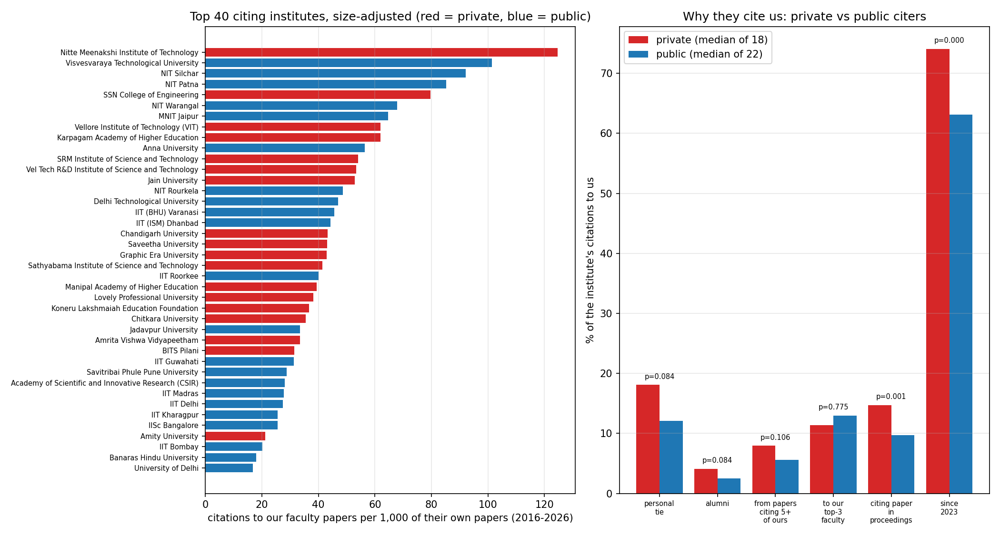
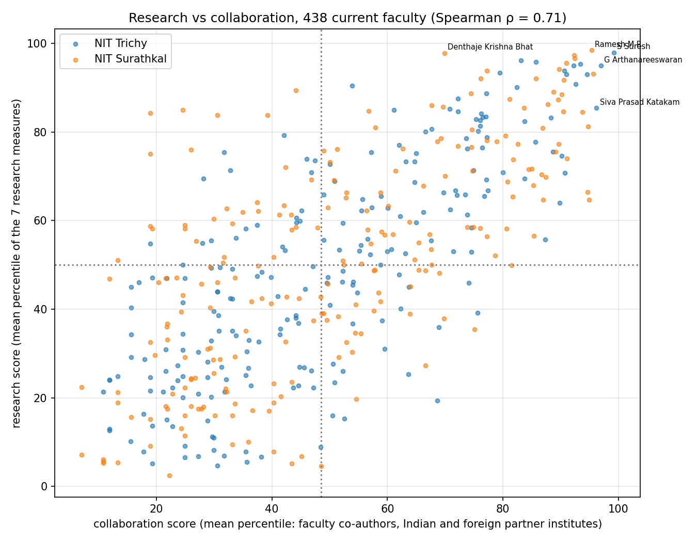
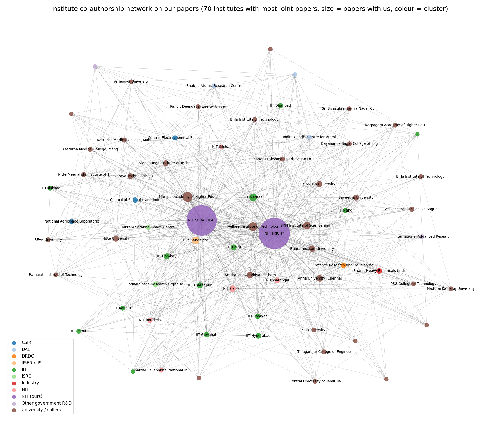

# Team 12: Phase II additions

This file covers eleven tasks from the professor's Phase II suggestions. They are produced by [scripts/phase2.py](../../../scripts/phase2.py):
- `python phase2.py papers` covers tasks 1, 3, 4, 5 and 6;
- `python phase2.py citers` covers task 2;
- `python phase2.py journals` covers tasks 7 and 9;
- `python phase2.py faculty` covers tasks 8 and 10;
- `python phase2.py instnet` covers task 11.

Running `python phase2.py` with no argument runs all five parts.

Every number is in the CSV/JSON files in this folder.

**Scope decisions (agreed as a team):**
- **Publication statistics** now also count papers by **students and other NIT staff**, meaning papers with an NIT author but no faculty author. The science and engineering subject filter is unchanged.
- These papers are in a separate file, `data/all_papers.csv`. **`group12_data.csv`, the faculty networks, the faculty rankings and the 44 checks stay faculty-only**, as the professor asked ("exclude students only from faculty-only networks").

**Built-in checks:**
- The faculty part of `all_papers.csv` must be identical to `group12_data.csv`: the same papers, quartiles, IF, type and citations. It is.
- The task 2 recount of citations must equal `cites_from_partner` in `indian_connections.csv` for all 40 institutes. It does.

---

## Task 1: Publication statistics including students' papers

**`data/all_papers.csv`** has **21,327 rows**, one per *(NIT, paper)*, covering **21,260 unique papers**:

| | Papers |
|---|---|
| With a faculty author | 18,343 (the current dataset) |
| **Students / other NIT staff only (new)** | **2,917** |
| Left out: business, economics, social sciences, psychology, arts | 1,158 |

Extra columns:
- `has_faculty_author`;
- `n_partner_institutions`, `n_indian_partners`, `n_foreign_partners`;
- `large_team_10plus`, `large_team_50plus`, `large_team_100plus`.

| | NIT Trichy, faculty | NIT Trichy, **all** | NIT Surathkal, faculty | NIT Surathkal, **all** | Both, faculty | Both, **all** |
|---|---|---|---|---|---|---|
| Papers | 9,184 | **10,950** | 9,206 | **10,377** | 18,343 | **21,260** |
| Journal / conference | 7,322 / 1,862 | 8,648 / 2,302 | 6,284 / 2,922 | 7,045 / 3,332 | 13,571 / 4,772 | 15,643 / 5,617 |
| Q1 papers | 2,391 | 2,821 | 2,222 | 2,448 | 4,599 | 5,248 |
| Q1 share of ranked journal papers | 35.2% | 35.9% | 38.3% | 38.2% | 36.6% | 36.9% |
| Citations | 140,035 | 176,476 | 125,280 | 140,970 | 264,423 | 315,869 |
| Citations per paper | 15.2 | 16.1 | 13.6 | 13.6 | 14.4 | 14.9 |
| Mean FWCI | 1.31 | 1.39 | 1.39 | 1.39 | 1.35 | 1.39 |

**What the student-only papers look like** (`student_only_papers_profile.csv`):

| | NIT Trichy | NIT Surathkal |
|---|---|---|
| Papers | 1,766 | 1,171 |
| Mean FWCI | **1.84** | 1.44 |
| Citations per paper | **20.6** | 13.4 |
| Conference share | 25% | 35% |
| With an outside co-author | 72% | 71% |

**Findings:**
- Counting students adds **16% more papers** (19% at Trichy, 13% at Surathkal).
- Their papers are **not weaker**. At NIT Trichy, student-only papers have *higher* impact (mean FWCI 1.84) than the faculty papers (1.31).
- Most student-only papers (71–72%) have an outside co-author. They are typically written by research scholars with collaborators elsewhere, without an NIT faculty author.
- Including them moves NIT Trichy's mean FWCI from 1.31 to 1.39, level with NIT Surathkal.

Files:
- `publication_statistics_both_scopes.csv`;
- `publication_trend_both_scopes.csv` (papers per year);
- `top_journals_both_scopes.csv` (top 15 journals per NIT and scope);
- `phase2_trend_and_collaborators.png`.

---

## Task 4: Papers by number of authors (< 10 vs ≥ 10)

| Scope | NIT | Fewer than 10 authors | 10 or more authors | Share of citations from ≥ 10-author papers | Mean FWCI (< 10 / ≥ 10) |
|---|---|---|---|---|---|
| All papers | NIT Trichy | 10,828 (98.9%) | **122 (1.1%)** | 2.0% | 1.38 / 1.99 |
| All papers | NIT Surathkal | 10,287 (99.1%) | **90 (0.9%)** | 1.7% | 1.38 / 2.88 |
| All papers | Both | 21,048 (99.0%) | **212 (1.0%)** | 1.9% | 1.38 / 2.36 |
| Faculty papers | Both | 18,202 (99.2%) | 141 (0.8%) | 1.5% | 1.34 / 2.07 |

**Finding:** only **1%** of papers have 10 or more authors, and they hold under 2% of all citations. The median paper has **3 authors**. Large-team papers are cited more per paper (FWCI about 2–3), but there are too few of them to distort any institute total.

Files: `author_count_classes.csv` and `author_count_classes_by_year.csv`.

---

## Task 5: Q1 papers in journals with IF > 5 and IF > 10 (both conditions together)

IF is the journal's 2-year mean citedness in OpenAlex: the impact-factor formula applied to open data.

| Scope | NIT | Q1 | IF > 5 | **Q1 and IF > 5** | IF > 10 | **Q1 and IF > 10** |
|---|---|---|---|---|---|---|
| Faculty | NIT Trichy | 2,391 | 2,413 | **1,586** (21.7% of journal papers) | 352 | **337** (4.6%) |
| Faculty | NIT Surathkal | 2,222 | 2,124 | **1,481** (23.6%) | 280 | **272** (4.3%) |
| Faculty | Both | 4,599 | 4,523 | **3,056** | 632 | **609** |
| All | NIT Trichy | 2,821 | 2,865 | **1,888** | 425 | **408** |
| All | NIT Surathkal | 2,448 | 2,327 | **1,618** | 308 | **300** |
| All | Both | 5,248 | 5,172 | **3,491** | 731 | **706** |

**Findings:**
- **Almost every IF > 10 paper is also Q1** (609 of 632). Very high-impact journals are nearly all top-quartile.
- **IF > 5 and Q1 overlap much less.** About a third of IF > 5 papers are in journals that aren't Q1 in their subject area, and many Q1 journals have IF < 5.
- **By branch** (`q1_if_by_branch.csv`), the most Q1 and IF > 5 papers come from:
  - NIT Surathkal: Mechanical (336) and Chemistry (238);
  - NIT Trichy: Chemical (250), Chemistry (199), Mechanical (185) and Physics (183).

  Mathematics has almost none (17 at Surathkal), because mathematics journals rarely reach IF 5.

Files: `q1_if_by_branch.csv`, `q1_if_by_year.csv` and `publication_statistics_both_scopes.csv`.

---

## Task 6: Number of collaborating institutions per year

For each NIT and year: the number of **distinct** other institutions on its papers. The other NIT counts as a partner. All papers (including students) are shown below; faculty-only figures are in the CSV.

| Year | Trichy: Indian | Trichy: foreign | Trichy: countries | Surathkal: Indian | Surathkal: foreign | Surathkal: countries |
|---|---|---|---|---|---|---|
| 2016 | 115 | 84 | 32 | 103 | 78 | 31 |
| 2018 | 154 | 125 | 33 | 124 | 110 | 38 |
| 2020 | 208 | 247 | 54 | 171 | 154 | 39 |
| 2022 | 227 | **272** | 57 | 198 | 197 | 53 |
| 2024 | 236 | 194 | 51 | 218 | 156 | 49 |
| 2025 | **241** | 193 | 51 | 211 | **223** | 52 |

**Totals 2016–2026:**

| | NIT Trichy | NIT Surathkal |
|---|---|---|
| Collaborating institutions | **1,712** | **1,534** |
| Indian | 615 | 564 |
| Foreign | 1,022 | 911 |
| Countries | 85 | 80 |

Faculty-only papers alone give 1,238 and 1,161 institutions.

**Findings:**
- **Indian partners roughly doubled** from 2016 to 2025 at both NITs (115 → 241 and 103 → 211), rising almost every year.
- **Foreign partners grew fast up to about 2021–22**, then levelled off or dipped. NIT Trichy peaked at 272 foreign institutions in 2022, and NIT Surathkal had dips in 2022–24.
- **Share of papers with any outside co-author:**
  - NIT Surathkal rose from about 39–42% (2016–19) to 46–51% (2020–25);
  - NIT Trichy rose from 43–50% to 51–55%.

Files: `collaborating_institutions_by_year.csv` and `collaborating_institutions_total.csv`.

---

## Task 3: Flags for large-team papers and very high citations

The professor noted that some physics faculty reach 1 lakh (100,000) citations, or have papers with 10–100 authors, and asked us to detect and flag them. **We checked, and there is no such case at our two NITs.**

| Check | Result |
|---|---|
| Faculty with career citations ≥ 1 lakh (OpenAlex, all of the person's IDs added up) | **None.** The highest is Ramesh M R at 20,427 |
| Any NIT author with a downloaded profile, students included | **None.** The highest is 18,792 |
| Papers with ≥ 10 authors | 212 (1.0%); 141 of them have a faculty author |
| Papers with ≥ 50 / ≥ 100 authors | 2 / 1. Both are computer-science benchmark papers without a faculty author: VisDrone-DET2018 (100 authors) and the GEM benchmark (56) |
| Physics papers with ≥ 10 authors | 1, the Event Horizon Telescope paper (48 authors, 2025, no faculty author) |
| Largest faculty paper | 22 authors |
| Faculty whose citations come **mostly** (≥ 50%) from ≥ 10-author papers | **1**: Mohan Lal Meena (Chemical, Surathkal). 6 papers, of which 2 have 10+ authors, and 91.5% of his 59 citations come from them. Small numbers, so it has no effect on any ranking |

**One more problem found:** two faculty have huge OpenAlex career totals that **almost entirely come from other people**:
- **Kunwar Singh** (CSE, Trichy): 15,552 career citations, but only 201 (**1.3%**) are from his NIT papers;
- **Aditya Kumar** (Energy & Environment, Trichy): 11,804, with only 24 (**0.2%**) from NIT papers.

OpenAlex has almost certainly **merged several people with the same name** into one profile. We flag them (`flag_possible_openalex_name_merge`). **The career h-index in `faculty.csv` for these two people should not be trusted.** Our rankings use only 2016–2026 NIT papers, so they are not affected.

**Conclusion for the report:**
> "The large-team and high-citation distortion seen at some physics-heavy institutes does not apply to NIT Trichy or NIT Surathkal. No faculty member has 1 lakh citations, only 1% of papers have 10 or more authors, and the only large physics collaboration paper has no faculty author."

Files:
- `flag_large_team_papers.csv` (all 212, with the faculty on each);
- `flag_faculty_citations_and_large_teams.csv` (per faculty member: career citations, papers with 10+ authors, share of citations from them, and the three flags);
- `flag_top_career_citations_any_nit_author.csv`.

---

## Task 2: Why do private institutes cite us so much?

**The question.** The institutes that cite our faculty papers most are mostly **private universities**: VIT (3,341 citations), Saveetha (2,624), SRM (2,573), Manipal, Chandigarh University and Lovely Professional University. Why?

**Method:**
1. Take the **40 institutes** that cite our faculty papers most. Together they give about **35% of all citations we receive from Indian institutes** (38,559 citations).
2. Label each as **private** (18) or **public** (22) by hand from its official status. The labels are listed in `CITER_LABELS` in the script.
3. For every citation, under the same co-authorship rule as the rest of the project, measure:

| Possible explanation | What we measure |
|---|---|
| **They're just big** | Their total papers 2016–2026 (OpenAlex) and citations to us per 1,000 of their papers |
| **They're nearby** | Distance from the institute to the NIT it cites |
| **Personal ties** | Does the citing paper share an author with the cited paper, include a **former NIT member** (someone who published with NIT affiliation earlier; usually a former PhD student or post-doc), or include an **earlier co-author** of the cited faculty? |
| **Citation packing** | How many of our papers each citing paper cites, and the share of citations from papers citing **5 or more** of ours |
| **Concentration** | Share of their citations that go to our **top 3** faculty |
| **Kind of citing paper** | Is the citing paper in conference proceedings, and how often is the citing paper itself cited? |
| **Timing** | Share of their citations from 2023–2026 |

4. Compare the 18 private and 22 public institutes with a Mann–Whitney test, and the individual citations with a chi-square test.

| Measure (median per institute) | Private (18) | Public (22) | p |
|---|---|---|---|
| Citations to us | 841 | 707 | 0.25 |
| Their own papers, 2016–2026 | 21,725 | 21,606 | 0.65 |
| **Citations to us per 1,000 of their papers** | 43 | 37 | **0.28 (no difference)** |
| **Distance to the NIT they cite** | **411 km** | 1,664 km | **0.049** |
| Citations with a personal tie | 18.1% | 12.1% | 0.08 |
| …from an earlier co-author of the cited faculty | 3.4% | 2.0% | **0.013** |
| …from a former NIT member (alumnus) | 4.1% | 2.5% | 0.08 |
| Our papers per citing paper | 1.31 | 1.29 | **0.60 (no difference)** |
| Citations from papers citing 5+ of ours | 7.9% | 5.6% | 0.11 |
| Share going to our top 3 faculty | 11.4% | 13.0% | 0.78 |
| **Citing paper in conference proceedings** | **14.7%** | 9.7% | **0.0007** |
| **Citations received by the citing paper** (median) | **5.3** | 8.0 | **0.0002** |
| **Citations from 2023–2026** | **74%** | 63% | **< 0.0001** |

Across all individual citations, private citers have a personal tie **20.8%** of the time, against **17.7%** for public ones (chi-square p < 10⁻¹³).

### Findings: the reasons, ranked by evidence
1. **Mostly size and recent growth, not unusual behaviour.**
   - VIT, Saveetha and SRM are among the largest publishers in India (48,000–61,000 papers each in 2016–2026).
   - **Adjusted for size, private institutes cite us no more than public ones**: 43 vs 37 per 1,000 papers, no significant difference.
   - The biggest private citers are **mid-table** on this measure: VIT 62, SRM 54, Saveetha 43.
   - Their citations are **recent**: 74% since 2023 (83% for Saveetha), which follows the fast growth of private-university publishing.
2. **They're nearby.** Private citers are a median of **411 km** away (Tamil Nadu and Karnataka), against 1,664 km for public ones. This matches what we found for co-authorship: research links are local.
3. **Somewhat more personal ties.**
   - Private citers more often include an **earlier co-author** of the cited faculty (significant) or a **former NIT member** (borderline).
   - These are likely former NIT research scholars now teaching at nearby private colleges, who keep citing their supervisors' and their own NIT work.
4. **Their citing papers are lower-impact.** They are more often in conference proceedings (15% vs 10%) and are themselves cited less (median 5 vs 8 citations). The high citation counts reflect high **volume** more than high-impact use.
5. **No general sign of citation packing or of a few faculty being favoured.** Private citing papers cite about the same number of our papers each (1.31 vs 1.29), and their citations are spread across our faculty as widely as public ones' are.

**Exceptions worth flagging** (`citers_by_institute.csv`). A few institutes do show heavy packing tied to personal links. They are mostly in Karnataka and connected to NIT Surathkal, and they include **public** ones:

| Institute | Type | Citations from papers citing 5+ of ours | Personal ties | Former NIT members | Per 1,000 of their papers |
|---|---|---|---|---|---|
| Nitte Meenakshi Institute of Technology | private | **39%** | **60%** | 20% | **125** (highest) |
| IISc Bangalore | public | 34% | 44% | 19% | 26 |
| Visvesvaraya Technological University | public | 33% | 50% | 14% | 101 |
| Jain University | private | 28% | 30% | 10% | 53 |

These are best explained by **alumni and supervisor networks**, not by private status.

**Conclusion for the report:**
> "Private universities top our list of citers mainly because they are very large, publish heavily since 2023 and are geographically close; adjusted for size they cite us no more than public institutes. Their citations come somewhat more often through personal ties (former NIT scholars and co-authors) and appear in lower-impact papers, but we find no general evidence of citation packing or targeting of a few faculty. The few institutes with heavy packing (e.g. Nitte Meenakshi, VTU) are explained by alumni networks."

**Caveats:**
- **Alumni are under-counted.** Only people who published with an NIT affiliation **in 2016–2026** can be detected, and authors without an OpenAlex ID are missed. The tie percentages are therefore lower bounds.
- **Institute size counts all of their papers in every field.** Saveetha and Manipal are large in medicine and dentistry, which makes their size-adjusted rate look lower than for engineering alone.
- **The private/public labels are ours**, from the institutes' official status, and can be checked in the script.

Files:
- `citers_by_institute.csv` (all measures for each of the 40 institutes, plus its three most-cited faculty);
- `citers_private_vs_public.csv`;
- `citers_ties_private_vs_public.csv`;
- `citers_by_year_private_vs_public.csv`;
- `citers_summary.json`;
- `citers_private_vs_public.png`.

---

## Data downloaded for Phase II
`fetch_insights.py citerout`: the 2016–2026 paper count of each of the 40 citing institutes, 40 OpenAlex requests → `data/raw/citer_output.jsonl`. Everything else uses data already in the repo.

## Found while doing this (for the team)
- **`clusters.py` mislabels NIT Silchar.** OpenAlex spells it "National Institute **Of** Technology Silchar", and the case-sensitive name rule labels it "University / college" instead of "NIT". Making the NIT rule case-insensitive fixes it.
- **Two faculty career profiles are polluted by same-name researchers:** Kunwar Singh (T0472) and Aditya Kumar (T0665). See task 3.
- **Repository deposits counted as journal papers.** 163 papers whose OpenAlex type is "article" are in repositories (Zenodo, DOAJ) or book series; 34 of them are faculty papers. `build_dataset.py` labels them `journal`. See task 9.

---

## Task 7: Top 30 publications by journal impact factor

**Rule (team decision):**
- Papers are ordered by their **journal's IF** (OpenAlex 2-year mean citedness), and papers in the same journal by their **own citations**.
- Only venues that are **real journals and are ranked by SCImago (Q1–Q4)** count. This keeps out proceedings series and venues the open IF data can't be trusted for.
- The only high-IF venue left out (IF ≥ 10) was *DROPS (Schloss Dagstuhl)*, IF 17.6, which is a repository / proceedings series, not a journal (`top30_excluded_high_if_venues.csv`).
- There are two lists:
  - **all papers**, including students' (`top30_papers_by_journal_if_all_papers.csv`);
  - **faculty papers** only (`top30_papers_by_journal_if_faculty_papers.csv`).

**Top 10, all papers:**

| # | Paper (shortened) | Journal | IF | Year | Citations | NIT |
|---|---|---|---|---|---|---|
| 1 | DDoS attacks at the application layer: challenges and research perspectives | IEEE Communications Surveys & Tutorials | 43.6 | 2018 | 178 | Surathkal |
| 2 | Securing the IoT application layer from an MQTT protocol perspective | IEEE Communications Surveys & Tutorials | 43.6 | 2024 | 109 | Surathkal |
| 3 | DERMS cybersecurity scenarios, trends and potential technologies: a review | IEEE Communications Surveys & Tutorials | 43.6 | 2025 | 36 | Trichy |
| 4 | Are lead-free relaxor ferroelectric materials the most promising candidates for energy storage capacitors? | Progress in Materials Science | 34.5 | 2022 | 426 | Trichy |
| 5 | Fundamental physics opportunities with the next-generation Event Horizon Telescope | Living Reviews in Relativity | 34.2 | 2025 | 46 | Surathkal (no faculty author) |
| 6 | Applicability of machine learning in spam and phishing email filtering | Artificial Intelligence Review | 33.2 | 2020 | 165 | Surathkal |
| 7 | Systematic study on deep-learning-based plant disease detection | Artificial Intelligence Review | 33.2 | 2023 | 104 | Surathkal |
| 8 | Microplastics in mangroves and coral reef ecosystems: a review | Environmental Chemistry Letters | 32.9 | 2021 | 168 | Trichy (no faculty author) |
| 9 | Carbon nanotube- and graphene-based advanced membrane materials for desalination | Environmental Chemistry Letters | 32.9 | 2017 | 79 | Surathkal |
| 10 | Antibiofouling hollow-fibre membranes for dye rejection | Environmental Chemistry Letters | 32.9 | 2018 | 70 | Surathkal |

**Findings:**
- The 30 papers come from only **13 journals**, because a few top journals contribute several papers each:
  - *Coordination Chemistry Reviews*: 6, NIT Trichy chemistry;
  - *Environmental Chemistry Letters*: 5, mostly Arun Mohan Isloor, NIT Surathkal.
- **Reviews and surveys dominate.** At least 12 of the 30 titles are reviews or surveys: the highest-IF journals mostly publish reviews.
- **The split between the NITs is even:** 16 Surathkal and 14 Trichy.
- **4 of the 30 have no faculty author** (student or other NIT-affiliated authors), for example the Event Horizon Telescope paper.
- **Faculty with several top-IF papers:** Arun Mohan Isloor (4), R Karvembu (3), P Santhi Thilagam, Annapureddy Venkateshwarlu, Jaidhar C D and S Velmathi (2 each).
- **A high journal IF doesn't guarantee citations.** One top-30 paper, in the new journal *Internet of Things and Cyber-Physical Systems* (IF 30.2), has **0 citations**. That's why we also report FWCI and citations alongside IF.

---

## Task 8: Each faculty member's top 10 papers by journal IF

`faculty_top10_papers_by_journal_if.csv`:
- **5,100 rows** for **635 faculty**, using the same rule as task 7 (SCImago-ranked journals, ties broken by citations);
- each row: rank, title, journal, IF, quartile, year, citations, FWCI, DOI;
- the median faculty member has a full list of 10, and faculty with fewer eligible papers get all they have;
- **21 faculty with papers have no paper in a SCImago-ranked journal**, mostly people who publish in conferences or unranked journals, so they have no list.

This file can feed a click-through on the dashboard's faculty table.

---

## Task 9: Most-used journals and conferences

`most_used_journals_and_conferences.csv`: the **top 25 journals and top 15 conference venues** for each NIT, both NITs together and both scopes. Each row has papers, share, quartile, IF, citations per paper and mean FWCI.

**Repository venues are not ranked as journals.** OpenAlex marks some deposits as "articles", for example **Zenodo** (79 papers) and **DOAJ** (23). The dataset therefore counts them as journal papers, but they are not journals. They're excluded from this list and saved in `flag_journal_papers_in_non_journal_venues.csv`: 163 papers, 34 of them faculty papers.

**Top journals, all papers:**

| # | NIT Trichy | Papers | Mean FWCI | NIT Surathkal | Papers | Mean FWCI |
|---|---|---|---|---|---|---|
| 1 | Materials Today: Proceedings (unranked) | 326 | 0.80 | Materials Today: Proceedings (unranked) | 247 | 0.65 |
| 2 | Trans. Indian Institute of Metals (Q3) | 97 | 0.82 | IEEE Access (Q1) | 115 | 2.11 |
| 3 | J. Materials Eng. & Performance (Q2) | 89 | 0.85 | Materials Research Express (Q3) | 82 | 0.98 |
| 4 | J. Alloys and Compounds (Q1) | 68 | 1.89 | J. Materials Eng. & Performance (Q2) | 79 | 0.91 |
| 5 | Materials Research Express (Q3) | 65 | 1.01 | J. Alloys and Compounds (Q1) | 52 | 2.09 |

**Findings:**
- **The single most-used venue at both NITs is *Materials Today: Proceedings*:** 572 unique papers, unranked by SCImago and with **below-average impact** (mean FWCI 0.65–0.80).
- Among the frequently used journals, the highest impact comes from:
  - *Fuel* (NIT Trichy, 55 papers, mean FWCI **4.73**);
  - *Construction and Building Materials* (Surathkal, 39 papers, FWCI **4.77**);
  - *Scientific Reports* (Surathkal, 3.60);
  - *Int. J. Hydrogen Energy* (Trichy, 2.97).
- **Conferences:** *Lecture Notes in Civil Engineering* is the top conference venue at both NITs (427 papers at Surathkal), with only about 2 citations per paper.
- This is evidence for advice on **where to publish**.

---

## Task 10: Collaboration in the faculty comparison

**Rule (team decision):** the agreed 7-measure **research score** (insights section 7) is unchanged. Next to it is a separate **collaboration score**: the average percentile of 3 measures, for the same 438 current faculty with at least 10 papers.

| Measure | How |
|---|---|
| NIT faculty co-authors | Degree in the faculty co-authorship network |
| Indian partner institutes | Distinct Indian institutes on the person's papers, other than their own NIT. Our count agrees with the network file at Spearman ρ = 0.98 |
| Foreign partner institutes | Distinct foreign institutes on the person's papers. The number of foreign countries is shown too |

File: `faculty_research_and_collaboration.csv`, with both scores, both ranks, all measures and a profile label for each person.

**Top 10 by collaboration:**

| # | Faculty | NIT, department | Faculty co-authors | Indian partners | Foreign partners (countries) | Research rank |
|---|---|---|---|---|---|---|
| 1 | S Suresh | Trichy, Mechanical | 14 | 36 | 28 (15) | 2 |
| 2 | G Arthanareeswaran | Trichy, Chemical | 9 | 29 | 47 (22) | 10 |
| 3 | Siva Prasad Katakam | Trichy, MME | 10 | 26 | 17 (11) | 37 |
| 4 | Jeny Rajan | Surathkal, CSE | 10 | 21 | 21 (8) | 16 |
| 5 | Ramesh M R | Surathkal, Mechanical | 22 | 53 | 10 (9) | 1 |
| 6 | Mangalpady Aruna | Surathkal, Mining | 11 | 20 | 17 (11) | 135 |
| 7 | Kartick Tarafder | Surathkal, Physics | 11 | 34 | 11 (9) | 56 |
| 8 | Mohammad Rizwanur Rahman | Surathkal, MME | 12 | 37 | 10 (6) | 123 |
| 9 | N Siva Shanmugam | Trichy, Mechanical | 9 | 30 | 14 (8) | 18 |
| 10 | Sib Sankar Mal | Surathkal, Chemistry | 7 | 27 | 24 (13) | 44 |

**Findings:**
- **Research and collaboration go together, but not perfectly** (Spearman ρ = 0.71).
  - Number of partner institutes is tied to papers and citations (ρ ≈ 0.64).
  - It is barely tied to impact per paper: FWCI against faculty co-authors gives ρ = 0.19. **Collaborating more brings more papers, not necessarily better ones.**
- **Four profiles** (split at the median of each score):

  | Profile | Trichy | Surathkal |
  |---|---|---|
  | Strong research, strong collaboration | 84 | 85 |
  | Strong research, **few collaborators** | 20 | 30 |
  | Collaborates widely, lower research score | 24 | 26 |
  | Both below median | 93 | 76 |

  - **Strong research, few collaborators** is mostly **NIT Surathkal CSE and IT**: e.g. Alwyn Roshan Pais (research #25, collaboration #245), Ram Mohana Reddy Guddeti and P Santhi Thilagam. They publish strongly, mainly with their own students, and have few faculty or outside partners.
  - **Collaborates widely, lower research score:** e.g. Sushil Kumar Pandey (ECE, Surathkal) and R Justin Joseyphus (Physics, Trichy). Many partners have not yet turned into high-impact output.
- **Foreign reach:** G Arthanareeswaran, R Karvembu and S Anandan each have 47–69 foreign partner institutes in 22 countries.

---

## Task 11: Institute-level co-authorship network

**Rule (team decision):**
- **Nodes:** every **Indian** institute that appears on our papers (all papers, including students'; papers with more than 50 authors left out, as elsewhere), including our two NITs.
- **Edges:** two institutes are linked when they appear on the **same paper**, weighted by the number of such papers.

So the network shows not only NIT–partner links but also **partner–partner links** that our papers create, for example IIT Madras–Anna University on a paper with an NIT Trichy author.

| | Value |
|---|---|
| Institutes / links | **826 / 4,147** (2,969 of the links don't involve our NITs) |
| Density / average clustering | 0.012 / 0.66 |
| Louvain communities / modularity | 13 / 0.28 |
| Institutes linked to **both** NITs | **353** |
| Joint papers NIT Trichy – NIT Surathkal | 67 (all papers; 47 with faculty from both) |
| Largest connected group without our two NITs | **85%** of the remaining institutes |

**Findings:**
- **Our NITs are hubs, but not the only glue.** With both NITs removed, 85% of the other institutes are still connected to each other through partner–partner links on our papers. Our papers bring other institutes together as well as linking them to us.
- **Two regional neighbourhoods.** The layout puts Karnataka institutes (Manipal, Nitte, VTU, Siddaganga, Ramaiah, IISc) around NIT Surathkal and Tamil Nadu institutes (Anna University, Bharathidasan, SASTRA, PSG, Saveetha) around NIT Trichy. The shared partners sit between them: VIT, IIT Madras, IISc and the other IITs, which matches the geography result.
- **Most important partner institutes** (most links and highest betweenness): Manipal (602 joint papers, links to 141 institutes), VIT (439, 117), SRM (275, 107), IIT Madras (277, 97) and IISc (266, 85).
- **By cluster** (`institute_network_by_cluster.csv`): universities and colleges are most numerous (507 institutes). **IITs are the best-connected type** (on average 29 links each, against 8 for universities), followed by IISER / IISc (20) and other NITs (17).
- **The strongest partner–partner links are often one organisation listed twice**: Manipal and its Kasturba Medical Colleges, CECRI and CSIR, ISRO and Vikram Sarabhai Space Centre, the two BITS campuses. They reflect authors listing a parent body and a sub-unit, not true collaboration between institutes. They're kept but should be read that way (`institute_coauthorship_edges.csv`, `institute_cluster_mixing_partner_links.csv`).

**Files:**

| File | Contents |
|---|---|
| `institute_coauthorship_nodes.csv` | Every institute: cluster, papers with us, degree, betweenness, community, linked to which NIT |
| `institute_coauthorship_edges.csv` | Every link, with joint papers and whether it involves our NITs |
| `institute_network_by_cluster.csv`, `institute_cluster_mixing_partner_links.csv` | Summaries by cluster |
| `institute_network_summary.json` | Headline numbers |
| `institute_coauthorship.gexf` | For Gephi |
| `institute_coauthorship_network.png` | Chart |

**Caveats:**
- **The network is built from our papers only.** Partner–partner links appear only where both partners are on a paper with an NIT author, so it's an "our view" network, not all of Indian research.
- **NIT Silchar's cluster is corrected here.** It's labelled NIT using a case-insensitive name check (see "Found while doing this").
