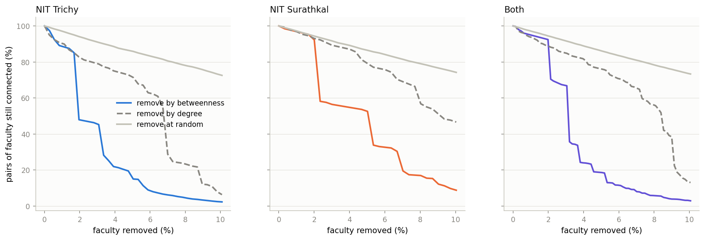
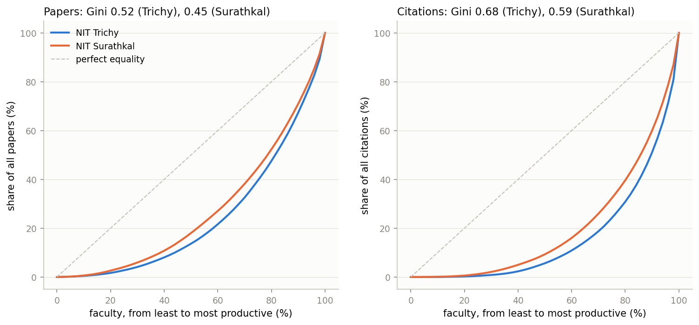
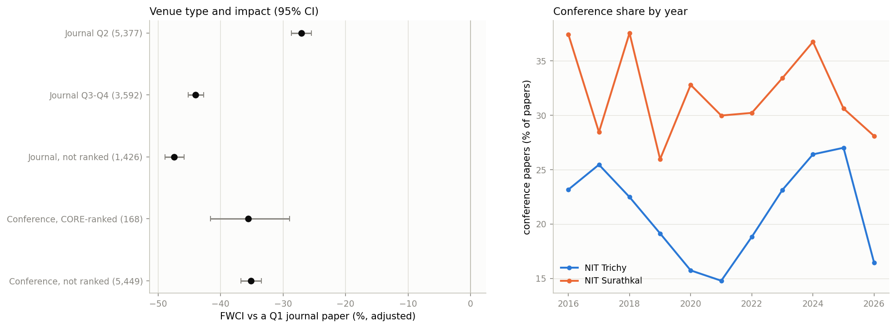
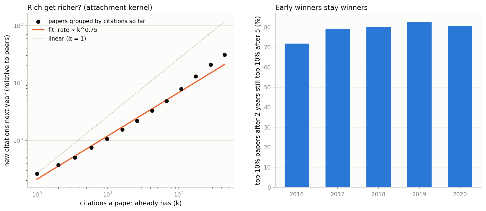
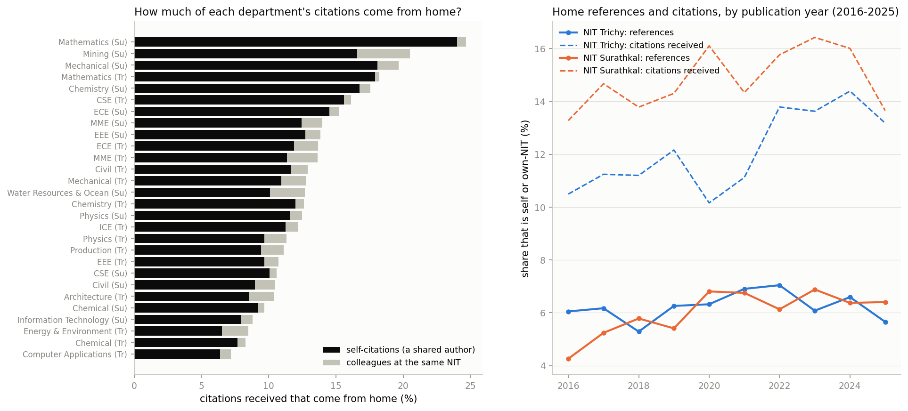
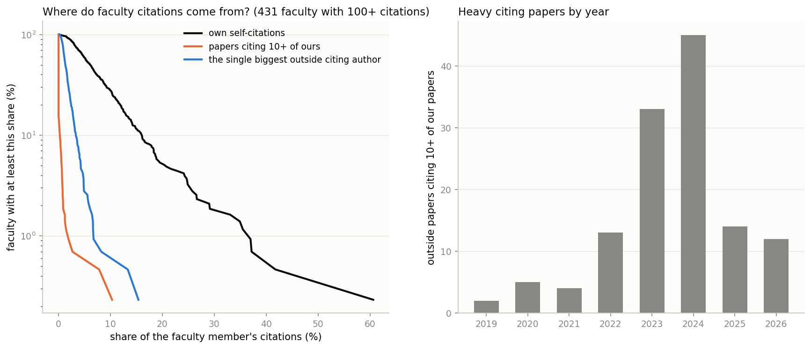

# Team 12: research questions (Phase II, part 2)

Phase II asks for "meaningful research questions and evidence-based conclusions". This file answers 13 of them (items 15–28 of our list). They are produced by [scripts/questions.py](../../../scripts/questions.py):

| Command | Questions |
|---|---|
| `python questions.py collab` | 15 (countries), 16 (partner types) |
| `python questions.py network` | 17 (key-person risk) |
| `python questions.py people` | 18 (former faculty), 19 (inequality), 20 (who leads), 21 (specialists vs generalists) |
| `python questions.py venues` | 22–23 (where to publish), 24 (open access) |
| `python questions.py richer` | 25 ("rich get richer") |
| `python questions.py robust` | 27 (name-matching sensitivity) |
| `python questions.py inward` | 26 (how much departments cite their own institute) |
| `python questions.py manipulation` | 28 (citation-manipulation check) |

Running `python questions.py` with no argument runs all eight parts. Every number below is in the CSV and JSON files in this folder.

**Scope (same rule as Phase II):**
- Questions about **papers** (15, 16, 22–25) use `data/all_papers.csv`, so they include papers by students and other NIT staff. Where it matters, the faculty-only number is given too.
- Questions about **faculty** (17–21, 26–28) use faculty data only.

**How "impact" is compared.**
- We use FWCI (citations relative to papers of the same field, year and type).
- Where we say "adjusted", we fit the same regression as the team's earlier model (`network_science.py`): log(1 + FWCI) on year, field, NIT, venue type, number of authors and collaboration, with robust (HC1) standard errors.
- "+18%" means 18% higher FWCI than otherwise similar papers.

**Built-in checks:**
- Our regression code (numpy) re-fits the team's earlier model and must give **the same coefficients and standard errors** as `ns_regression_full.txt`. It does.
- The robustness curves start at the faculty network's real giant component.
- The Gini code is checked against a direct pairwise formula.
- The faculty network rebuilt for question 27 must have exactly the 961 faculty links of the published network. It does.

**Data downloaded:** `fetch_insights.py yearly`, 213 OpenAlex requests on 11 November 2026 → `data/raw/works_yearly.jsonl`.
- It holds citations per year (`counts_by_year`) and open-access status for all 21,260 papers.
- 20,965 were found. The other 295 are IDs OpenAlex has since merged.

---

## 15. Which countries do we collaborate with, and does it help?

**3,645 of 21,260 papers (17%)** have a co-author from abroad, from **94 countries**.

| Country | Papers | Trichy / Surathkal | Mean FWCI | Adjusted FWCI difference | Faculty member on most of them |
|---|---|---|---|---|---|
| United States | 800 | 305 / 497 | 1.98 | +7% | Santhosh George (25%) |
| South Korea | 393 | 240 / 154 | 2.45 | **+20%** | N Siva Shanmugam (9%) |
| Saudi Arabia | 312 | 219 / 94 | 2.08 | +3% (not significant) | S Anandan (27%) |
| United Kingdom | 265 | 143 / 123 | 3.27 | **+40%** | Bibhuti Bhusan Das (17%) |
| Taiwan | 261 | 234 / 27 | 1.64 | +7% | S Anandan (42%) |
| China | 194 | 132 / 63 | 2.90 | +15% | Karthikeyan S S (13%) |
| Chile | 186 | 172 / 14 | 1.30 | −3% (not significant) | S Anandan (22%) |
| Malaysia | 183 | 105 / 83 | 2.68 | **+21%** | G Arthanareeswaran (25%) |
| Canada | 179 | 103 / 76 | 2.14 | +14% | Arun Mohan Isloor (12%) |
| Australia | 146 | 108 / 38 | 2.44 | +20% | S Anandan (29%) |
| Vietnam | 107 | 87 / 20 | 5.30 | **+67%** | N Samsudeen (8%) |

**Findings:**
- **A foreign co-author goes with higher impact.**
  - Adjusted: **+18%** FWCI (all papers) and **+14%** (faculty papers, the same as the team's earlier result).
  - In raw terms: mean FWCI 2.07 vs 1.25, and 23% vs 13% of papers in the world's top 10%.
- **More countries, more impact.** One foreign country is +13%; two or more countries is **+35%**.
- **The partner country matters.**
  - The UK (+40%), Malaysia, South Korea and Australia (about +20%) bring the most.
  - Saudi Arabia, Japan and Chile bring no significant gain.
  - Vietnam is the highest (+67%), but it is only 107 papers, so the range is wide (+44% to +95%).
- **Many country links are one person's network.** S Anandan (Chemistry, Trichy) is on 42% of the Taiwan papers, 29% of Australia's, 27% of Saudi Arabia's and 22% of Chile's. Santhosh George (Mathematics, Surathkal) is on a quarter of the US papers. These links would weaken if that person left (see question 17).
- **Trend.**
  - The foreign share rose from 15% (2016) to a peak of 20% (2022), then fell back to 16% (2025).
  - At NIT Trichy it went from 16% to 22% (2020–21) and back to 16%. NIT Surathkal stayed at 13–19%.
  - The number of partner countries per year rose from 44 to 70 (2021–22).

Files: `q15_countries.csv`, `q15_foreign_effect.csv`, `q15_effect_by_number_of_countries.csv`, `q15_foreign_by_year.csv`, `q15_countries.png`.

---

## 16. Does collaborating with stronger institutes raise impact?

Each paper's outside partners were sorted into types, using the team's cluster rules (`clusters.py`) and the OpenAlex institution type. Each type gets one term in the regression; the comparison is a paper without that partner type.

| Partner type | Papers | Mean FWCI | Adjusted FWCI difference (95% CI) |
|---|---|---|---|
| Foreign university | 3,493 | 2.08 | **+17%** (+14 to +20) |
| Foreign other (labs, hospitals) | 440 | 2.76 | +8% (+0.5 to +16) |
| Other NIT | 827 | 1.70 | +5% (+0.6 to +10) |
| IIT | 1,279 | 1.49 | +3% (−1 to +6), not significant |
| IIIT | 114 | 1.68 | +6%, not significant |
| Indian university / college | 4,988 | 1.57 | +1%, not significant |
| Industry | 398 | 1.60 | −5% (−11 to +1), not significant |
| Government R&D lab (CSIR, DAE, ISRO, DRDO…) | 1,306 | 1.31 | **−6%** (−9 to −3) |
| IISER / IISc | 322 | 1.11 | **−10%** (−15 to −4) |
| No outside partner | 11,356 (53%) | 1.24 | (comparison) |

**Findings:**
- **Only foreign partners clearly raise impact.** IIT partners, the "strong" Indian partners, bring no significant gain once field, year and team size are taken into account.
- **Government labs and IISc / IISER partners go with slightly lower FWCI.** A "strong" partner name is not a sign of higher impact by itself.
- **Indian university partners became much more common.** They were on 19% of papers in 2016 and 27% in 2025. Papers with no outside partner fell from 56% to 52%.
- **Advice for each NIT:** to raise impact, partner abroad (especially the UK, Korea, Malaysia and Australia). Indian partnerships add papers, not impact per paper.

Files: `q16_partner_types.csv`, `q16_partner_types_by_year.csv`, `q16_partner_types.png`.

---

## 17. Key-person risk: what if a hub faculty member leaves?

We take the faculty co-authorship network (656 faculty, 961 links) and remove faculty one by one:
- by **betweenness** (the bridges), recomputed after each removal;
- by number of co-authors (**degree**);
- at **random** (mean of 100 runs).

After each removal we count how many **pairs of faculty can still reach each other**.

| | NIT Trichy | NIT Surathkal |
|---|---|---|
| Faculty / links | 357 / 429 | 299 / 504 |
| Largest connected group | 65% of faculty | 85% |
| Pairs lost if the **top 5 bridges** leave | 13% | 5% |
| Pairs lost if the **top 10 bridges** leave (3% of faculty) | **54%** | **44%** |
| Pairs lost if the top 20 bridges leave | 89% | 70% |
| Pairs lost if **10 random** faculty leave | 8% | 9% |

**Findings:**
- **The network is robust to random departures but fragile to losing its bridges.** That is the classic pattern of a network with hubs. Losing the 10 main bridges disconnects about half of all faculty pairs at each NIT, against 8–9% for 10 random departures.
- **The first bridges to go:**
  - NIT Trichy: N Sivakumaran, S Suresh, P Palanisamy, S Saravanan, Aneesh Mathew;
  - NIT Surathkal: Gangadharan K V, Pruthviraj U, Mohammad Rizwanur Rahman, A Venkata Narasimhadhan, Amba Shetty.
- **Inside departments**, one person often holds the group together. In **19 of 27 departments**, losing one person cuts more than a quarter of the department's connected pairs. Examples:

  | Department | Key person | Pairs in the department cut if they leave |
  |---|---|---|
  | Trichy, Computer Applications | S Nickolas | 58% |
  | Surathkal, Physics | Ajith Kulangara Madam | 51% |
  | Trichy, Mathematics | V Ravichandran | 50% |
  | Surathkal, Chemical | Keyur Raval | 48% |
  | Trichy, Mechanical | S Suresh | 47% |
  | Trichy, Civil | S T Ramesh (HAG) | 46% |

- **Who are the key people?** 15 of the 20 most critical people overall are Professors or Professors (HAG), the most senior ranks. Each department should plan for these links to be taken over when they retire or move.

Files: `q17_robustness_curves.csv`, `q17_key_people_overall.csv`, `q17_key_people_by_department.csv`, `q17_robustness.png`.

---

## 18. Do people who left the NITs differ from those who stayed?

There are 99 former faculty with papers and 557 current ones. Medians are compared with Mann–Whitney tests.

| Measure (median) | Current | Former | p |
|---|---|---|---|
| Papers per year on the faculty list | 3.3 | 2.5 | 0.013 |
| Citations per paper | 9.0 | 10.7 | 0.06 |
| Mean FWCI | 1.07 | 0.91 | 0.12 |
| h-index (2016–2026) | 8 | 6 | 0.004 |
| Indian partner institutes | 4 | 2 | < 0.001 |

**Within each rank the picture changes.**
- **Former Assistant Professors are not weaker.** They are as productive as current ones (2.3 vs 2.0 papers a year) and are cited *more* per paper (7.1 vs 4.5, p = 0.003).
- **Former Professors are less productive** (2.3 vs 4.1 papers a year, p = 0.008). Most of them retired.

**Where did they go?** We used the last institution on their OpenAlex profile:

| Now at | Former faculty |
|---|---|
| Still listed at the same NIT (mostly retired; OpenAlex profiles lag) | 60 |
| An IIT | 8 |
| Another NIT | 7 |
| An Indian university | 7 |
| Government R&D (ISRO, CEERI) | 2 |
| Abroad | 1 |
| No current institution / no profile | 14 |

**Finding: the brain drain is junior.** Of the **28 former Assistant Professors, 12 moved to an IIT (6) or another NIT (6)**. Examples:
- IIT Tirupati, IIT Jammu, IIT Goa, IIT Palakkad, IIT BHU and IIT Dhanbad;
- NIT Calicut, NIT Raipur, NIT Rourkela and NIT Kurukshetra.

The NITs lose promising young faculty, not weak ones, mostly to IITs and newer NITs.

**Caveat:** "former" includes retirements. The roster comes from yearly archived web pages, so years are approximate.

Files: `q18_former_vs_current.csv`, `q18_where_former_faculty_went.csv`.

---

## 19. How unequal is research output?

| Faculty with papers | Gini, papers | Gini, citations | Top 10% hold … of citations | Bottom 50% hold … of citations |
|---|---|---|---|---|
| NIT Trichy (357) | 0.52 | **0.68** | **49%** | 6% |
| NIT Surathkal (299) | 0.46 | 0.59 | 40% | 9% |
| Both (656) | 0.49 | 0.64 | **45%** | 7% |

**Findings:**
- **The top 10% of faculty hold 45% of all citations; the bottom half hold 7%.** If the 111 faculty with no papers are counted, the top 10% hold 49%.
- **NIT Trichy is more unequal than NIT Surathkal** (Gini 0.68 vs 0.59 for citations). Trichy's output depends more on a few stars, which links to question 17.
- **Most unequal departments:**
  - Trichy Chemistry (Gini 0.72; S Anandan alone has 39% of its citations);
  - Surathkal Mathematics (0.70);
  - Trichy Civil (0.69).

  **Most equal:** Surathkal Physics (0.42), Chemistry (0.45) and Water Resources (0.47).
- **Lotka's law holds** for all NIT-affiliated authors, students included (10,876 OpenAlex author IDs).
  - The fitted exponent is **1.9–2.0**, the classic value of 2.
  - 56% of authors have a single paper; Lotka's law predicts 57%.
  - For faculty alone the law doesn't apply, because faculty are already the productive authors (only 5% have a single paper).

Files: `q19_inequality.csv`, `q19_inequality_by_department.csv`, `q19_lorenz.csv`, `q19_lotka.csv`, `q19_lorenz.png`.

---

## 20. Who leads the research: senior or junior faculty?

We use the author's position on each paper (first, middle or last) and the corresponding-author flag, from OpenAlex. The flag is available for 70% of rows.

| Rank | Faculty-paper rows | First author | Last author (usually the supervisor) | Middle | Corresponding author |
|---|---|---|---|---|---|
| Assistant Professor | 3,530 | **12%** | 50% | 37% | 44% |
| Associate Professor | 4,499 | 6% | 55% | 38% | 45% |
| Professor | 9,490 | 3% | **58%** | 39% | 39% |
| Professor (HAG) | 4,188 | 4% | 57% | 39% | 41% |

The difference between ranks is highly significant (chi-square 469, p < 10⁻⁹⁰).

**Findings:**
- **NIT faculty usually lead their papers.** A faculty member is the first, last or corresponding author on **80%** of faculty papers. This holds even on papers with outside partners (63%), so the NITs are mostly the lead, not a helper, in their collaborations.
- **Seniority shows in author order.**
  - Professors are almost never first author (3%); they are the last-author supervisors.
  - Assistant Professors are first author 4× as often.
- **Junior faculty are becoming supervisors faster.** The share of Assistant Professor papers with them as first author fell from **29% in 2016 to 7% in 2025**. Young faculty now publish mainly with their own students, as last author.
- **Leading a paper doesn't change its impact.** Adjusted FWCI is −1% (p = 0.33) when an NIT faculty member leads.

Files: `q20_author_role_by_rank.csv`, `q20_author_role_by_rank_and_year.csv`, `q20_author_roles.png`.

---

## 21. Do specialists or generalists have more impact?

**Measure.** For the 494 faculty with 10 or more papers, research breadth is the variety (Shannon entropy) of the OpenAlex subfields of their papers.
- It is averaged over random sets of **10 papers** each, so that people with more papers don't look broader just because of that.
- We also rank breadth within each department, because CSE and Mathematics differ in how many subfields exist.

| Breadth group | Faculty | Median papers | Mean FWCI | Median h-index |
|---|---|---|---|---|
| Most specialised | 124 | 28.5 | 1.20 | 9 |
| Specialised | 123 | 35 | 1.28 | 10 |
| Broad | 123 | 35 | 1.21 | 10 |
| Broadest | 124 | 41.5 | **1.44** | 12 |

| Correlation with breadth (Spearman) | All | Within department | Controlling for number of papers |
|---|---|---|---|
| Mean FWCI | 0.12 (p = 0.006) | 0.09 (p = 0.04) | 0.08 (p = 0.07) |
| h-index | 0.15 (p = 0.001) | 0.12 (p = 0.007) | 0.03 (p = 0.5) |
| Median FWCI | 0.00 | 0.01 | −0.05 |

**Finding: broad research is rewarded only a little.**
- The broadest quarter has a higher mean FWCI (1.44 vs 1.20) and h-index.
- But the link is weak (ρ ≈ 0.1) and mostly disappears once the number of papers is taken into account.
- Median FWCI shows no link at all. The higher mean comes from a few broad people with very highly cited papers.
- In short, neither specialists nor generalists are clearly better; productive people tend to be a little broader.

Files: `q21_research_breadth_by_faculty.csv`, `q21_breadth_vs_impact.csv`, `q21_breadth_groups.csv`, `q21_breadth_vs_fwci.png`.

---

## 22–23. Where to publish: are conference papers worth it, and do the most-used venues hurt impact?

| Venue type | Papers | Mean FWCI | Top-10% share | Adjusted FWCI vs a Q1 journal paper |
|---|---|---|---|---|
| Journal Q1 | 5,248 (25%) | 2.41 | 28% | (comparison) |
| Journal Q2 | 5,377 | 1.25 | 12% | −27% |
| **Conference, not ranked by CORE** | 5,449 (26%) | 1.22 | 13% | **−35%** |
| Conference, CORE-ranked | 168 | 1.53 | 11% | −36% |
| Journal Q3–Q4 | 3,592 | 0.66 | 5% | −44% |
| Journal, not ranked | 1,426 | 0.60 | 4% | **−47%** |

**Findings:**
- **A conference paper is worth less than a Q1/Q2 journal paper, but more than a Q3–Q4 or unranked journal paper.**
  - It reaches the top 10% about as often as a Q2 paper (13% vs 12%).
  - Moving a typical conference paper to a Q3–Q4 journal would not raise its impact.
- **The conference share is steady:** 30% in 2016, 29% in 2025. NIT Surathkal publishes more at conferences (26–38% a year) than Trichy (15–27%).
- **By department**, the conference share is highest in Surathkal IT (68%) and CSE (63%). There, conference papers have about half the FWCI of the same department's journal papers (0.44–0.54×). In EEE and ECE they are close to journal papers (0.76–1.05×).
- **The most-used venues** are the 13 with 100 or more papers, holding 14% of all papers. Each is compared with all other papers of the same field and year:

  | Venue | Papers | Mean FWCI | Adjusted difference |
  |---|---|---|---|
  | *Materials Today: Proceedings* (journal, not ranked) | 572 | 0.74 | **−20%** |
  | *Transactions of the Indian Institute of Metals* (Q3) | 139 | 0.81 | −18% |
  | *Communications in Computer and Information Science* | 187 | 0.80 | −14% |
  | *Lecture Notes in Networks and Systems* | 185 | 0.73 | −13% |
  | *Lecture Notes in Civil Engineering* | 543 | 1.32 | −9% |
  | *IEEE Access* (Q1) | 136 | 2.34 | **+37%** |
  | *Journal of Alloys and Compounds* (Q1) | 120 | 1.98 | **+33%** |

  **The two most-used venues at both NITs (*Materials Today: Proceedings* and *Lecture Notes in Civil Engineering*) both lower impact.** Moving that work to ranked journals in the same areas, such as *Journal of Alloys and Compounds* or *IEEE Access*, would raise it.

Files: `q22_venue_classes.csv`, `q22_conference_share_by_year.csv`, `q22_conference_by_department.csv`, `q23_high_volume_venues.csv`, `q22_venues.png`.

---

## 24. Does open access raise citations?

**22%** of papers are open access (open-access status from OpenAlex, downloaded 11 November 2026). NIT Surathkal's share rose from 24% (2016) to 30% (2025); NIT Trichy's from 19% to 22%.

| Status | Papers | Mean FWCI | Citations per paper | Adjusted vs closed | … and same venue type |
|---|---|---|---|---|---|
| Closed | 16,274 (77%) | 1.35 | 14.9 | (comparison) | (comparison) |
| Gold (open-access journal) | 1,349 | 2.01 | 21.4 | **+13%** | +6% |
| Green (free copy in a repository) | 731 | 2.05 | 20.7 | **+10%** | +8% |
| Diamond (free to publish and read) | 1,308 | 1.13 | 7.8 | **−12%** | +2% |
| Hybrid | 654 | 1.39 | 13.6 | −6% | +1% |
| Bronze (free to read on the publisher site) | 649 | 1.15 | 14.1 | −13% | −4% |

**Findings:**
- **Open access by itself does not raise impact.** All open papers together have −2% FWCI (not significant).
- **It depends on the kind of open access.**
  - **Gold and green** go with +10–13% higher FWCI.
  - **Diamond** goes with −12%; only 7% of these papers are in Q1 journals.
- **Most of the gap is the journal, not the openness.** Compared with papers in the same venue type (quartile), every difference shrinks to between −4% and +8%. A free copy in a repository (green) keeps the clearest gain (+8%), and it costs nothing.
- **Caveat:** this is a correlation. Authors may choose open access for their better papers.

Files: `q24_open_access.csv`, `q24_open_access_by_year.csv`, `q24_open_access.png`.

---

## 25. "Rich get richer": do well-cited papers get new citations faster?

This is preferential attachment, the mechanism behind scale-free networks from class.
- **Data:** for each paper we rebuilt its citations at the end of every year from OpenAlex's citations per year. The yearly counts add up exactly to the total for 99.7% of papers.
- **Method:** for 61,184 paper-years we compared the citations a paper already had (k) with the citations it received in the next year. Each paper is compared with papers of the same year and age.
- **Attachment kernel:** if new citations grow like k^α, then α = 1 is linear preferential attachment.

**Findings:**
- **Yes, the rich get richer, but sub-linearly.** New citations grow as **k^0.75**.
  - A paper with 55–88 citations gets **35×** as many new citations next year as an uncited one, and 5× the average for its age.
  - α grows with age: 0.78 (age 1–2 years), 0.92 (3–5) and **1.00** (6 or more, linear).
- **Early winners stay winners.** Of the papers in the top 10% after 2 years, **72–83% are still in the top 10% after 5 years** (cohorts 2016–2020). The 2-year and 5-year citation ranks correlate at ρ = 0.90–0.94.
- **The concentration is stable.** The top 10% of each cohort hold about 45% of its citations, both after 2 years and after 5.
- **What this means:** the first two years decide most of a paper's citation future. Making a paper visible early (preprint or green open access, talks, a good venue) matters more than anything done later.

Files: `q25_attachment_kernel.csv`, `q25_alpha_by_age.csv`, `q25_top_papers_stay_on_top.csv`, `q25_rich_get_richer.png`.

---

## 26. How much do departments cite their own institute?

**Method.** We take every reference of every faculty paper (628,377 references, 34 per paper) and every citation the papers received (264,393). Each link is sorted into one group:

| Group | Meaning |
|---|---|
| **Self** | The two papers share at least one author |
| **Colleague** | No shared author, but the other paper has an author from the same NIT |
| **Other NIT** | Trichy ↔ Surathkal |
| **Other Indian** | Any other Indian institute |
| **Outside India** | The rest |

"Home" = self + colleague. Author and institution details come from `fetch_links.py`, which covers Indian papers only. A self-citation in a paper written abroad is therefore missed, so the home shares are lower bounds.

| | NIT Trichy | NIT Surathkal | Both |
|---|---|---|---|
| References that are home | 6.2% | 6.2% | 6.2% (self 5.5%, colleague 0.7%) |
| References to other Indian institutes | 12.7% | 11.2% | 12.0% |
| References outside India | 81.0% | 82.4% | 81.7% |
| **Citations received from home** | **11.7%** | **14.8%** | **13.2%** (self 11.9%, colleague 1.2%) |
| Citations from other Indian institutes | 24.4% | 21.8% | 23.2% |
| Citations per paper, all / without home | 15.3 / 13.5 | 13.6 / 11.6 | 14.5 / 12.5 |

**Findings:**
- **About one citation in eight comes from home**, and it is almost all **self-citation** (11.9%). Colleagues at the same NIT give only 1.2%. This matches the citation network: our faculty rarely cite each other's papers. "Inward-looking" here means people citing their own earlier work, not the institute citing itself.
- **NIT Surathkal is more inward-looking** (14.8% of citations from home vs 11.7% at Trichy). It rose from 13% in 2016 to 14–16% in 2020–2024. Trichy's rose from 10–11% to 13–14% in 2022–2024.
- **Most inward departments** (share of citations from home):

  | Department | From home | Of which self |
  |---|---|---|
  | Surathkal Mathematics | **25%** | 24% |
  | Surathkal Mining | 21% | 17% |
  | Surathkal Mechanical | 20% | 18% |
  | Trichy Mathematics | 18% | 18% |
  | Surathkal Chemistry | 18% | 17% |

  **Least inward:** Trichy Computer Applications (7%), Trichy Chemical (8%), Trichy Energy & Environment (9%) and Surathkal IT (9%).
- **Departments that cite themselves more are also cited more by themselves** (Spearman ρ = 0.64 across 28 departments, p < 0.001). But home citations are not linked to department FWCI (ρ = −0.27, p = 0.16).
- **Removing home citations barely changes the department ranking** by citations per paper. No department moves more than 2 places: Surathkal Chemistry goes from 2nd to 4th, Trichy Chemistry from 3rd to 2nd.

Files: `q26_inward_overall.csv`, `q26_inward_by_department.csv`, `q26_inward_by_year.csv`, `inward_summary.json`, `q26_inward.png`.

---

## 27. How sensitive are the results to name matching?

**What counts as doubtful.** Faculty were matched to OpenAlex author IDs by name, department and ORCID (`match_faculty.py`). The weakest links are **463 name-only matches of an ID that has a single NIT paper**. A stricter set of 96 also has a department mismatch or a student with a similar name. We dropped them and re-ran the main results.

| Measure | All links | Without the 463 doubtful links |
|---|---|---|
| Faculty-paper rows | 21,933 | 21,494 (−439, −2.0%) |
| Papers, Trichy / Surathkal | 9,184 / 9,206 | 9,007 / 9,082 (−1.9% / −1.3%) |
| Q1 share | 36.6% | 36.6% |
| Mean FWCI | 1.35 | 1.36 |
| Median h-index (2016–2026) | 8 | 8 |
| Top-20 faculty ranking | — | **20 of 20 the same** (Spearman 0.999) |
| Faculty network links | 961 | 914; top-10 betweenness: 9 of 10 the same |
| NIT Surathkal vs Trichy FWCI (adjusted) | +1.2% (p = 0.22) | +1.1% (p = 0.27) |
| Foreign co-author effect | +14.9% | +14.8% |
| Conference effect | −14.2% | −14.4% |

**Finding:** dropping the doubtful links changes no conclusion.
- Every institute total moves by less than 2%.
- The ranking's top 20 is identical, and the institute comparison stays "no significant difference".
- 35 low-output faculty would lose all their papers, because they were found only through single-paper IDs. That is why the number of faculty with papers falls (656 → 621) while the medians stay the same.

Files: `q27_name_matching_sensitivity.csv`, `robust_summary.json`.

---

## 28. Citation manipulation check

The professor asked us to look for citation manipulation, alongside the private-citer analysis (Phase II task 2). We look for three warning signs in the **117,909 citations from Indian papers** (77,176 citing papers):
1. **Heavy citing papers:** papers that cite 10 or more of our papers at once.
2. **Self-citation:** a large share of a person's citations coming from their own papers.
3. **One-person sources:** a large share coming from a single outside author.

All shares for faculty are shares of **all** their citations (2016–2026 papers). Flags apply to the 431 faculty with 100 or more citations.

**1. Heavy citing papers are rare.**

| A citing paper cites at least … of our papers | Citing papers | Share of our Indian citations | Outside papers (no author from our NITs) | … with a former NIT member |
|---|---|---|---|---|
| 1 | 77,176 | 100% | 66,591 | 7% |
| 5 | 2,847 | 17.6% | 1,065 | 43% |
| **10** | **430** | **5.0%** | **128** | **66%** |
| 20 | 58 | 1.1% | 35 | 66% |

- Most papers that cite 10+ of ours are written **by our own NITs** (302 of 430). That is normal for a group building on its own work.
- Only **128 outside papers** cite 10 or more of ours, giving 1,930 citations (under 1% of all citations to our papers). **Two-thirds of them have a former NIT member** as an author (someone who earlier published with an NIT affiliation).

**One concentrated pattern.**
- 57 of the 128 heavy outside papers cite mostly one faculty member: Ramesh M R (Mechanical, NIT Surathkal, #1 in the research ranking).
- 45 of the 128 appeared in 2024 alone, against 2–13 a year before 2023.
- 29 of the 57 are in one journal, *Journal of The Institution of Engineers (India) Series D*.
- One author is on **33** of the 128. He is on 28 of our NIT Surathkal papers, with an NIT Surathkal affiliation from 2018, i.e. a former NIT Surathkal member.
- In total, 10.3% of Ramesh M R's citations (and 7.8% of Sharnappa Joladarashi's, same department) come from heavy outside citing papers. No other faculty member is above 3%.
- This looks like a **former research group citing its earlier work in bulk**, not like a citation cartel. It is a pattern worth knowing, not proof of misconduct.

**2. Self-citation is moderate and concentrated in a few people.**

| Faculty with 100+ citations (431) | Median | Top 10% above | Top 1% above | Flagged |
|---|---|---|---|---|
| Own self-citations (the person on both papers) | 6.1% | 16% | 35% | **13** above 25% |
| Citations from heavy outside citing papers | 0% | 0.2% | 1.4% | **2** above 5% |
| Biggest single outside citing author | 1.3% | 3.3% | 6.6% | **2** above 10% |

- The 13 faculty above 25% self-citation mostly have modest totals (121–854 citations): when few others cite a person yet, their own citations weigh more. The highest is 61%. The names are in `q28_faculty_citation_sources.csv`.
- The two "one outside author" flags are two NIT Surathkal ECE faculty, 13–15% of whose citations come from the same outside author.

**3. Do these citations change any result?** No. We recomputed the faculty ranking (the 7-measure score) with citations and h-index counted:
- **without self-citations:** the top 20 is identical (Spearman 0.999). The largest drop is from rank 166 to 220.
- **without heavy citing papers:** the top 20 is identical (Spearman 1.000), and Ramesh M R stays #1.

**4. The 40 institutes that cite us most** (extends Phase II task 2):

| Institute | Type | Citations to us | From heavy citing papers | Biggest single author there | Top cited faculty |
|---|---|---|---|---|---|
| Visvesvaraya Technological University | public | 1,211 | **24%** | 11% (former NIT member) | Ramesh M R (22%) |
| Jain University | private | 853 | **24%** | 19% | Ramesh M R (18%) |
| Nitte Meenakshi Institute of Technology | private | 602 | **24%** | 12% (former NIT member) | Ramesh M R (16%) |
| Savitribai Phule Pune University | public | 618 | 19% | 16% | Ramesh M R (14%) |
| IISc Bangalore | public | 866 | 14% | 18% (former NIT member) | Subhaschandra Kattimani (15%) |
| Lovely Professional University | private | 1,088 | 12% | 15% | Ramesh M R (12%) |

- The **biggest citers are clean**. VIT, Saveetha, SRM and Manipal get only 0.4–2.2% of their citations to us from heavy papers, and no single author gives more than 4%.
- The heavy pattern sits in **a few Karnataka and Pune institutes, both private and public**, and points to the same Surathkal Mechanical group.
- Private institutes have slightly more heavy citations (median 2.3% vs 0.05%), but the difference is not significant (p = 0.06). Single-author shares are the same (5.1% vs 5.4%).

**Conclusion for the report:**
> "We find no sign that citation manipulation distorts our results. Only 5% of the citations we receive from Indian papers come from papers citing 10 or more of ours, and most of those are by our own NITs. Removing self-citations or heavy citing papers leaves the faculty ranking's top 20 unchanged. The one concentrated pattern (heavy citing papers in 2023–24 around one Surathkal Mechanical group, mostly by former NIT members) is consistent with an alumni network citing its own earlier work."

**Caveats:**
- Only citations from Indian papers carry author and institution details, so the heavy-paper and one-author measures cover about a third of all citations. Self-citations are covered almost fully, because a faculty member citing themself is almost always on an Indian paper.
- "Former NIT member" means someone who published with an NIT affiliation in 2016–2026. That includes former PhD students and post-docs, so it is a lower bound.
- These are statistical signals for follow-up, not judgements about any person. Citing your own or your group's earlier work is normal when it is relevant.

Files:
- `q28_heavy_citing_papers_distribution.csv`, `q28_heavy_outside_citing_papers.csv`, `q28_authors_of_heavy_citing_papers.csv`;
- `q28_faculty_citation_sources.csv`, `q28_faculty_citation_source_spread.csv`, `q28_ranking_without_self_or_heavy_citations.csv`;
- `q28_citing_institutes.csv`, `manipulation_summary.json`, `q28_citation_checks.png`.

---

## Found while doing this (for the team)
- **Ruben Sudhakar is on both rosters.** He moved from NIT Surathkal (S0085) to NIT Trichy (T0669), so some papers list him for both NITs. `build_networks.py` already counts him once per paper.
- **OpenAlex's corresponding-author flag is missing for 30% of rows**, so the corresponding-author shares in question 20 are based on the other 70%.
